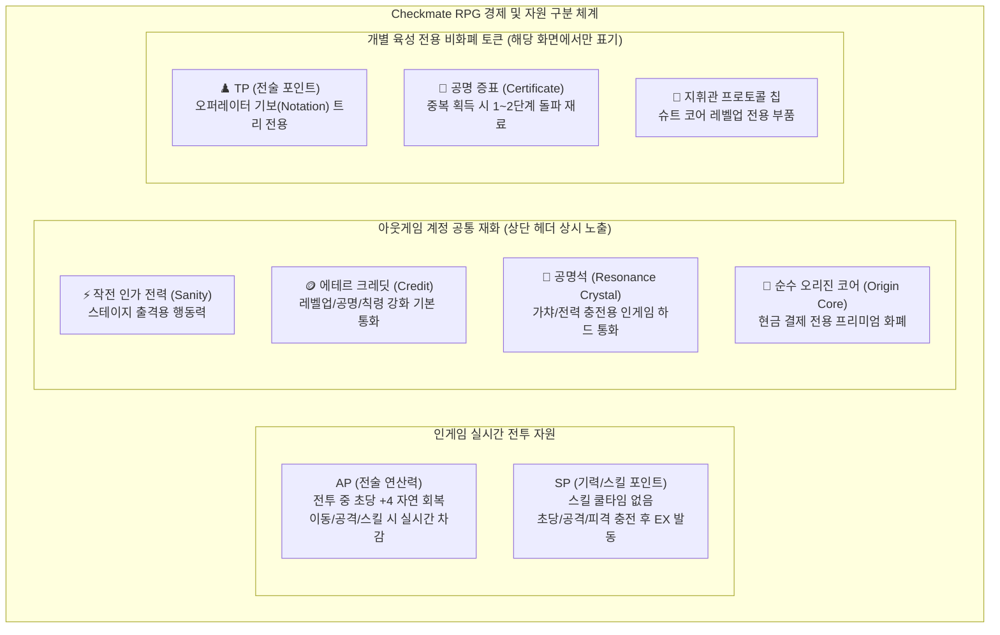
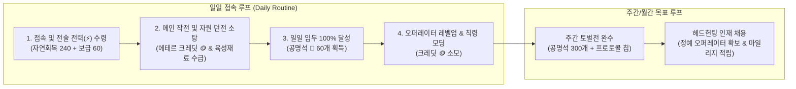

# [Project: Checkmate RPG] 인게임 재화 및 경제 시스템 기획서 (Economy & Currency Specification)

> **문서 버전:** v1.0 (공식 제정본)  
> **기준 일자:** 2026-09-28  
> **기획 방향성:** 체스 전술 RPG 기반 + 명일방주 / 블루 아카이브 / 붕괴: 스타레일 스타일의 **현대 서브컬처 4-Tier 경제 순환 모델**  
> **문서 상태:** 정식 기획 명세서 (Game Design Document)  
> **연동 시스템:** `SaveData`, `OutgameHeaderUI`, `BattleRewardService`, `RecruitHubUI`, `OperatorHubUI`

---

## 📑 목차 (Table of Contents)

1. [기획 의도 및 경제 설계 철학](#1-기획-의도-및-경제-설계-철학)
2. [용어 정의 및 핵심 자원 구분 원칙](#2-용어-정의-및-핵심-자원-구분-원칙)
3. [재화 4단계 계층 분류 매트릭스](#3-재화-4단계-계층-분류-매트릭스)
4. [재화별 상세 명세 및 밸런스 테이블](#4-재화별-상세-명세-및-밸런스-테이블)
   - 4.1 작전 인가 전력 (Operation Sanity / 스태미너)
   - 4.2 에테르 크레딧 (Aether Credit / 기본 화폐)
   - 4.3 공명석 & 순수 오리진 코어 (Resonance Crystal & Origin Core / 프리미엄 화폐)
   - 4.4 전술 소집 허가증 & 헤드헌팅 마일리지 (Headhunting Permits & Mileage)
   - 4.5 육성 특수 토큰 (기보 TP, 공명 증표, 지휘관 프로토콜 칩)
5. [일일/주간 경제 순환 및 수급 루프 (Inflow & Sink Loop)](#5-일일주간-경제-순환-및-수급-루프-inflow--sink-loop)
6. [헤드헌팅(가챠) 확률 및 천장(Pity) 시스템 규격](#6-헤드헌팅가챠-확률-및-천장pity-시스템-규격)
7. [UI/UX 화면 표기 및 인터랙션 규격](#7-uiux-화면-표기-및-인터랙션-규격)
8. [엔지니어링 데이터 연동 구조 (`SaveData` 확장안)](#8-엔지니어링-데이터-연동-구조-savedata-확장안)

---

## 1. 기획 의도 및 경제 설계 철학

### 1.1 배경 및 문제 정의
* 이전 아웃게임 UI에서는 개별 오퍼레이터의 기보 퍼즐 전용 포인트인 **TP(Tactical Points)**가 메인 로비와 헤더에 범용 계정 골드처럼 잘못 노출되는 구조적 결함이 있었습니다.
* 본 기획서는 이를 완전히 정리하고, 서브컬처 게이머들에게 가장 친숙하고 검증된 **"행동력(스태미너) - 소프트 통화(골드) - 하드 통화(무료/유료 캐시) - 소환권(티켓)"**의 표준 4단계 경제 시스템을 Checkmate RPG의 사이버네틱 체스 세계관에 완벽히 융합합니다.

### 1.2 핵심 설계 원칙 (Core Principles)
1. **직관적 3대 메인 자원 상시 가시화:** 플레이어가 로비나 화면을 볼 때 `[전력 ⚡]` / `[크레딧 🪙]` / `[공명석 💠]` 3종만으로 현재 자신의 활동 잠재력을 즉시 파악할 수 있도록 단순화합니다.
2. **피로도 없는 순환 루프:** 매일 1~2회 접속하여 자연 회복된 전력을 소모하고, 획득한 크레딧과 재료로 오퍼레이터를 육성하며, 일일/주간 임무로 공명석을 모아 원하는 픽업을 노리는 건전한 서브컬처 라이프사이클을 제공합니다.
3. **전투 자원과 아웃게임 자원의 완전한 분리:** 전투 중 실시간 회복되는 AP(전술 연산력)와 스테이지 진입용 스태미너의 명칭 및 역할을 명확히 격리합니다.

---

## 2. 용어 정의 및 핵심 자원 구분 원칙



| 구분 | 자원 명칭 | 영문 코드 | 사용 영역 | 주요 역할 |
| :--- | :--- | :--- | :--- | :--- |
| **전투 자원** | **전술 연산력** | `AP (Action Points)` | 인게임 전투 전용 | 기물 이동/공격 시 소모, 초당 +4 자연 회복 |
| **전투 자원** | **스킬 기력** | `SP (Skill Points)` | 인게임 전투 전용 | 스킬 100% 충전 시 액티브 스킬 발동 |
| **계정 재화** | **작전 인가 전력** | `Operation Sanity` | 아웃게임 출격 | 스테이지 진입 및 소탕 시 소모 (스태미너) |
| **계정 재화** | **에테르 크레딧** | `Aether Credit` | 아웃게임 전체 | 육성, 강화, 상점 구매 기본 소프트 화폐 |
| **계정 재화** | **공명석** | `Resonance Crystal` | 아웃게임 전체 | 헤드헌팅 소집, 전력 충전 (인게임 수급 하드 화폐) |
| **계정 재화** | **순수 오리진 코어**| `Pure Origin Core` | 아웃게임 전체 | 유료 결제 전용, 스킨/패키지 구매, 공명석 환전 |
| **육성 토큰** | **전술 포인트** | `TP (Tactical Points)` | 오퍼레이터 허브 | **기보(Notation) 퍼즐 노드 해금 전용 (화폐 아님!)** |
| **육성 토큰** | **공명 증표** | `Operator Certificate`| 오퍼레이터 허브 | 중복 획득 시 공명 1~2단계 돌파 재료 |

---

## 3. 재화 4단계 계층 분류 매트릭스

| Tier | 재화명 | 아이콘 심볼 | 보유 상한 | 일일 순환 주기 | 주요 수급처 | 주요 소비처 |
| :---: | :--- | :---: | :---: | :---: | :--- | :--- |
| **Tier 1<br/>(행동력)** | **작전 인가 전력**<br/>(Sanity) | ⚡<br/>`Neon Cyan` | 기본 120<br/>(최대 180) | 6분당 1 회복<br/>(1일 240 충전) | 시간 자연회복, 일일 점심/저녁 보급, 공명석 충전, 레벨업 | 메인 작전, 자원 던전 출격 및 연속 소탕 |
| **Tier 2<br/>(소프트)** | **에테르 크레딧**<br/>(Aether Credit) | 🪙<br/>`Tactical Gold` | 99,999,999 | 상시 누적 | 스테이지 클리어, 군수 수송 보급전, 임무 보상 | 오퍼레이터 레벨업, 공명 공정비, 칙령 회로 모딩 |
| **Tier 3<br/>(하드/무료)**| **공명석**<br/>(Resonance Crystal)| 💠<br/>`Prism Blue` | 무제한 | 주간/월간 누적 | 스테이지 첫 클리어, 일일/주간 임무, 업적, 이벤트 | 헤드헌팅(가챠 1회 150 / 10회 1,500), 전력 충전 |
| **Tier 3<br/>(하드/유료)**| **순수 오리진 코어**<br/>(Pure Origin Core)| 💎<br/>`Amber Diamond`| 무제한 | 상시 영구 보유 | 인앱 결제 (현금 구매) | 공명석 환전(1:100), 프리미엄 슈트 스킨, 시즌 패스 |
| **Tier 4<br/>(티켓/마일리지)**| **정예 소집 허가증**<br/>(Special Permit) | 🎫<br/>`Crimson Ticket`| 무제한 | 픽업 기간 누적 | 이벤트 보상, 패키지, 공명석 교환 | 신규/한정 오퍼레이터 픽업 헤드헌팅 |
| **Tier 4<br/>(티켓/마일리지)**| **일반 소집 허가증**<br/>(Standard Permit)| 🎫<br/>`Cyan Ticket` | 무제한 | 상시 누적 | 출석 체크, 일일 임무, 군수 보급소 교환 | 상시 정예 요원 헤드헌팅 |
| **Tier 4<br/>(티켓/마일리지)**| **헤드헌팅 증명서**<br/>(Recruit Certificate)| 📑<br/>`Slate Badge` | 무제한 | 마일리지 누적 | 가챠 1회당 1개 지급 | 300개 시 픽업 대원 확정 정가 교환, 상점 재료 교환 |

---

## 4. 재화별 상세 명세 및 밸런스 테이블

### 4.1 작전 인가 전력 (Operation Sanity / ⚡)
* **컨셉:** PRTS 전술 통신망에서 지휘관 슈트와 체스 오퍼레이터 간의 신경 동기화에 인가되는 에너지 대역폭.
* **수치 밸런스 규격:**
  - **자연 회복 속도:** **6분당 1 전력** (시간당 10 전력, 24시간 동안 총 240 전력 완충)
  - **기본 보유 상한:** 지휘관 슈트 코어 1레벨 기준 **120 전력**
  - **슈트 레벨 성장:** 슈트 레벨 1업당 최대 보유 상한 +2 증가 (최대 30레벨 기준 180 전력)
  - **오버플로우 정책:** 레벨업 또는 아이템 충전 시 최대치를 초과하여 최대 999까지 임시 보유 허용.
* **스테이지 소모량 테이블:**

| 콘텐츠 구분 | 스테이지 예시 | 소모 전력 | 비고 |
| :--- | :--- | :---: | :--- |
| 메인 작전 (초반) | Chapter 01 (OP-01 ~ OP-03) | **6 ~ 9** | 튜토리얼 및 초반 스토리 구간 |
| 메인 작전 (중반) | Chapter 01 (OP-04 ~ OP-05) | **10 ~ 12** | 보스전 및 정규 챕터 구간 |
| 군수 작전 (크레딧 던전) | [수송로 확보] Lv.1 ~ Lv.3 | **15 ~ 20** | 에테르 크레딧 대량 수급 전용 |
| 전술 훈련 (경험치 던전) | [모의 전술 훈련] Lv.1 ~ Lv.3 | **15 ~ 20** | 오퍼레이터 전술 기록 칩 수급 |
| 엘리트 토벌 (칙령 던전) | [에테르 코어 방어전] | **25 ~ 30** | 희귀 칙령 및 극성 회로 수급 |

* **충전 수단:**
  1. **비상 전력 팩 (Sanity Ration):** 소형(+30), 중형(+60), 대형(+120) 소모품 아이템 사용.
  2. **일일 정기 전술 보급:** 매일 12:00 / 18:00 접속 시 부관이 중형 전력 팩(60)을 우편 발송 (당일 소모 권장).
  3. **공명석 충전:** 1일 최대 10회 가능 (회차별 필요 공명석 점증: `40 -> 40 -> 60 -> 60 -> 80 -> 100 -> 120 -> 150 -> 180 -> 200`). 1회 충전당 고정 +60 전력 제공.

---

### 4.2 에테르 크레딧 (Aether Credit / 🪙)
* **컨셉:** 아크(ARK) 연합 기지의 공식 결제 화폐이자 전술 하드웨어 제작용 나노 자원.
* **주요 싱크(소비) 밸런스:**
  - **오퍼레이터 레벨업:** 경험치 100당 20 크레딧 소모. (1~50 만렙 달성 시 약 120,000 크레딧 소모)
  - **공명 돌파 (Resonance Upgrade):**
    - 1단계 돌파: 10,000 크레딧
    - 2단계 돌파: 40,000 크레딧
  - **킹 칙령 모딩 (Edict Modding):**
    - 일반 칙령 회로 슬롯 장착/교체: 1,500 크레딧
    - 슬롯 극성(Polarity) 변경 리롤: 25,000 크레딧
  - **군수 보급소 (상점):** 일반 성장 부품, 선물 아이템 등 일일 한정 품목 구매.

---

### 4.3 공명석 & 순수 오리진 코어 (💠 & 💎)
* **컨셉:** 체스판 세계관의 근원 물질인 "에테르 오리진"의 정제 결정체.

```text
[순수 오리진 코어 (💎)] ──(1:100 환전)──> [공명석 (💠)] ──> [헤드헌팅 소집 / 전력 충전]
         │
         └──> [지휘관 프리미엄 슈트 코스튬 / 한정 패키지]
```

* **공명석(무료 캐시) 수급 밸런스 기준 (F2P 유저 기준 한 달 약 40~50연차 보장):**
  - **스테이지 최초 클리어 보상:** 일반 스테이지 50개, 보스 스테이지 100개
  - **일일 임무 (Daily Missions):** 매일 60개 (월 1,800개 = 12회 소집분)
  - **주간 작전 (Weekly Missions):** 매주 300개 (월 1,200개 = 8회 소집분)
  - **신규 챕터 / 이벤트 배포:** 이벤트당 약 1,500~2,000개
* **헤드헌팅 비용:**
  - **1회 소집:** 공명석 **150개** (또는 소집 허가증 1장)
  - **10회 연속 소집:** 공명석 **1,500개** (4성 이상 1명 확정)

---

### 4.4 전술 소집 허가증 & 마일리지 (🎫 & 📑)
* **정예 소집 허가증 (Special Permit - 붉은색 티켓):**
  - 신규 출시 5성 오퍼레이터 전용 픽업 채널에만 사용 가능.
* **일반 소집 허가증 (Standard Permit - 시안색 티켓):**
  - 상시 헤드헌팅 채널에 상시 사용 가능.
* **헤드헌팅 증명서 (Headhunting Certificate - 마일리지 천장):**
  - 소집 1회마다 증명서 1개 자동 적립.
  - **300개 누적 시:** 해당 픽업 채널의 대상 5성 오퍼레이터 1명 확정 교환.
  - 픽업 종료 시 잔여 증명서는 상점 범용 교환 증표로 1:1 자동 이월되어 소멸하지 않음.

---

### 4.5 육성 특수 토큰 (비화폐성 자원)

#### ① TP (Tactical Points / 전술 포인트 / ♟️)
* **개념 재확인:** 계정 자원이 아니며, 오직 오퍼레이터의 **기보(Notation) 퍼즐 트리 전용 포인트**입니다.
* **획득 경로:**
  - 오퍼레이터 레벨업 시 5레벨마다 +1 TP 지급
  - 공명 1단계 돌파 시 +2 TP, 2단계 돌파 시 +3 TP 지급
  - 오퍼레이터 전술 숙련도(친밀도) 달성 시 최대 +5 TP 지급
* **소모:** 기보 트리 내 스탯 강화 노드(1 TP), 기물 고유 특성 노드(2 TP), 스킬 강화 노드(3 TP) 해금.

#### ② 공명 증표 (Operator Certificate / 🧩)
* **용도:** 이미 보유한 오퍼레이터를 헤드헌팅에서 중복으로 획득했을 때 자동 지급.
* **지급량:**
  - 3성 중복: 공명 증표 1장
  - 4성 중복: 공명 증표 5장
  - 5성 중복: 공명 증표 15장
* **소모량:** 공명 1단계 돌파(증표 5장), 공명 2단계 돌파(증표 15장).

---

## 5. 일일/주간 경제 순환 및 수급 루프 (Inflow & Sink Loop)



### 5.1 F2P 유저 기준 월간 재화 수지 예측표
* **월간 획득 공명석 합계:** 1,800 (일일) + 1,200 (주간) + 1,000 (출석/점검) = **4,000 공명석**
* **월간 획득 소집 허가증:** 출석 및 상점 교환 기준 약 **10장**
* **총 소집 가능 횟수:** 약 **36~40회 소집분** 상시 보장 (2개월마다 천장 1회 도달 가능).

---

## 6. 헤드헌팅(가챠) 확률 및 천장(Pity) 시스템 규격

명일방주 및 최신 서브컬처 표준의 **소프트 천장(Soft Pity)** 및 **하드 천장(Hard Guarantee)** 알고리즘을 적용합니다.

### 6.1 기본 확률 테이블
* **5★ 최고 등급 (최고급 오퍼레이터):** 기본 확률 **2.0%** (픽업 대상이 5성 등장 확률의 50% 점유)
* **4★ 정예 등급 (주력 오퍼레이터):** 기본 확률 **8.0%**
* **3★ 스탠다드 등급 (기초 기물 오퍼레이터):** 기본 확률 **90.0%**
* **10연속 소집 보정:** 10회 연속 소집 시 4성 이상 오퍼레이터 1명 100% 확정 보장.

### 6.2 소프트 천장 시스템 (점증 확률)
* **1 ~ 50회차:** 5성 획득 확률 **2.0%** 고정 유지.
* **51회차부터:** 매 1회 소집마다 5성 획득 확률이 **+2.0%씩 선형 증가**.
  - 51회차: 4.0%
  - 60회차: 22.0%
  - 70회차: 42.0%
  - **79회차:** 60.0%
  - **80회차:** **100.0% (하드 천장 - 5성 확정 지급)**
* 5성 오퍼레이터 획득 시 카운트는 즉시 0으로 초기화됩니다.

---

## 7. UI/UX 화면 표기 및 인터랙션 규격

### 7.1 통합 상단 네비게이션 헤더 (`OutgameHeaderUI`) 배치안

현재 상단 헤더 우측 영역에 서브컬처 표준 3대 재화 위젯을 고정 배치합니다.

```
+-----------------------------------------------------------------------------------------------+
| [< BACK] [HOME]  02 // OPERATIONS  작전 출격        [⚡ 120/120 +] [🪙 125,400] [💠 2,450 +]  |
|                                                     [COMMANDER // SUIT LV.1] [● PRTS ONLINE]  |
+-----------------------------------------------------------------------------------------------+
```

* **재화 슬롯 비주얼 규격:**
  - **배경:** `rgba(20, 23, 30, 0.85)` 사선 챔퍼 다크 서피스 바
  - **텍스트:** `UiFontProvider` 적용, 볼드 하이 콘트라스트 화이트
  - **[+] 충전 버튼:** 클릭 시 즉시 **"전력 충전 팝업"** 또는 **"공명석 보급 상점 팝업"** 모달 호출
* **타이틀 화면:** 헤더 전체 자동 은폐 (`alpha = 0`)
* **메인 로비:** 뒤로가기/홈 버튼 숨김, 재화 3종 및 지휘관 슈트 레벨 상시 표출
* **전투(BattleScene):** 아웃게임 재화 헤더는 렌더링되지 않으며, 인게임 전투 전용 `[PlayerAPBar]`가 하단에 활성화됨

### 7.2 재화 부족 시 알림 다이얼로그 (Shortage Dialog)
* 작전 출격 클릭 시 전력(⚡) 부족한 경우:
  - 팝업 제목: `[PRTS ALERT // 인가 전력 부족]`
  - 내용: `작전 수행에 필요한 인가 전력이 부족합니다.\n보유 비상 전력 팩을 사용하거나 공명석으로 충전하시겠습니까?`
  - 버튼: `[ 비상 전력 팩 사용 ]`, `[ 공명석 충전 (40 💠) ]`, `[ 취소 ]`

---

## 8. 엔지니어링 데이터 연동 구조 (`SaveData` 확장안)

### 8.1 `SaveData.cs` 확장 필드 명세

기존 `SaveData` 클래스의 호환성을 유지하면서, 신규 4-Tier 경제 필드를 추가합니다.

```csharp
namespace CheckmateRPG.Progression
{
    [System.Serializable]
    public class SaveData
    {
        // ==========================================
        // 1. 서브컬처 4-Tier 핵심 계정 재화 (신규)
        // ==========================================
        [Header("Currencies")]
        public int Sanity = 120;                  // 작전 인가 전력 (스태미너)
        public int MaxSanity = 120;               // 최대 인가 전력 상한
        public long LastSanityRecoverTimeTicks;   // 전력 자연회복 연산용 마지막 타임스탬프

        public long AetherCredit = 50000;         // 에테르 크레딧 (소프트 골드)
        public int ResonanceCrystals = 1500;      // 공명석 (인게임 수급 무료 하드 화폐)
        public int PaidOriginCores = 0;           // 순수 오리진 코어 (유료 결제 캐시)

        [Header("Gacha Tickets & Mileage")]
        public int StandardPermits = 5;           // 일반 소집 허가증 (상시 소환권)
        public int SpecialPermits = 0;            // 정예 소집 허가증 (픽업 소환권)
        public int HeadhuntingMileage = 0;        // 헤드헌팅 마일리지 (천장 증명서)
        public int PityCounter = 0;               // 5성 천장 스택 카운터 (0~80)

        // ==========================================
        // 2. 기존 육성 및 진행도 데이터 (보존)
        // ==========================================
        public List<string> UnlockedUnits = new List<string>();
        public List<string> CurrentDeck = new List<string>();
        public List<UnitProgressionSaveData> UnitProgressions = new List<UnitProgressionSaveData>();
        public KingProgressionSaveData KingProgression = new KingProgressionSaveData();
        public List<string> ClearedStages = new List<string>();

        // 레거시 호환용 (더 이상 계정 화폐로 취급하지 않음)
        [System.Obsolete("TP는 계정 화폐가 아니며, 유닛별 UnitProgressionSaveData에서 관리됩니다.")]
        public int TacticalPoints;

        public SaveData()
        {
            LastSanityRecoverTimeTicks = System.DateTime.UtcNow.Ticks;
        }
    }
}
```

### 8.2 전투 보상 파이프라인 연동 (`BattleRewardService.cs`)
* 스테이지 클리어 시:
  - **첫 클리어:** 대량의 에테르 크레딧(`AetherCredit`) + 공명석(`ResonanceCrystals` 50~100개) 지급.
  - **반복 클리어:** 표준 에테르 크레딧(`AetherCredit`) + 오퍼레이터 경험치 칩 지급.
  - 출격 시 차감된 전력(`Sanity`) 정상 반영.

---

## 9. 기획 검토 및 다음 마일스톤 액션 아이템

1. **기획서 검토 및 승인:** 본 명세서의 재화 명칭, 수치, 가챠 확률, 상단 헤더 배치안에 대해 검토.
2. **코드 반영 (다음 단계):**
   - `SaveData.cs`에 신규 재화 필드 직렬화 추가 및 세이브 마이그레이션.
   - `OutgameHeaderUI.cs`에 `[⚡ 전력]`, `[🪙 크레딧]`, `[💠 공명석]` 3종 위젯 추가 및 실시간 데이터 갱신 바인딩.
   - `StageSelectUI.cs` 출격 전력 체크 및 `BattleRewardService.cs` 크레딧/공명석 보상 지급 연동.
   - `RecruitHubUI.cs` 소집 시 소집 허가증 또는 공명석 150/1,500개 차감 연동.
