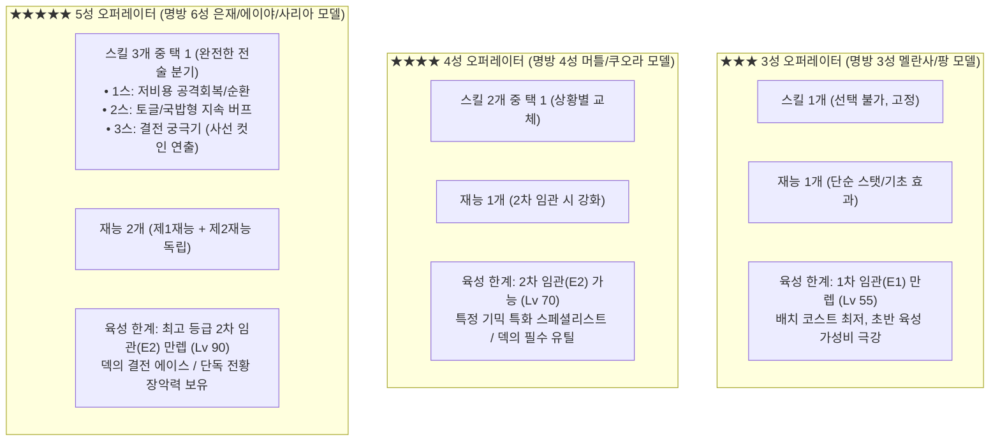

# ♟️ Checkmate RPG — 명일방주(Arknights) 기반 캐릭터 밸런스 아키텍처

> **문서 버전:** v2.0 (명일방주 시스템 1:1 매핑 완전판)  
> **기준 타겟:** Checkmate RPG (체스 전술 RPG × 명일방주 메커니즘 융합)  
> **설계 원칙:** 명일방주의 검증된 **[스킬 슬롯 체계], [재능(패시브) 위계], [SP 회복 3대 방식], [감산식/비율식 전투 수식]**을 체스 기물 시스템에 완벽히 동기화  
> **영구 보존 경로:** [Arknights_Style_Balance_Architecture.md](file:///c:/Users/VR13/Downloads/20260917/Graduation_Project_v01/Docs/Character_Sheets/Arknights_Style_Balance_Architecture.md)  

---

## 1. 명일방주(Arknights) ↔ Checkmate RPG 코어 시스템 1:1 대응표

| 명일방주 (Arknights) 시스템 | Checkmate RPG 대응 시스템 | 핵심 메커니즘 및 밸런스 규칙 |
|:---|:---|:---|
| **배치 코스트 (DP)** | **배치 코스트 & 실시간 AP** | 덱 배치 시 코스트 소모 + 전장 초당 **+4.0 AP** 실시간 회복 |
| **뱅가드 (선봉)** | **폰 (Pawn: 척후대 / 돌격대 등)** | 초반 저비용 전선 전개, **초당 +0.8 AP 생산(척후대)** 또는 킬 시 15 AP 환불(돌격대) |
| **가드 (전위)** | **나이트 (Knight: 검객 / 돌격기사 등)** | 장애물 무시 L자 기동, 1대1 물리 누킹, 다단히트 암살 |
| **디펜더 (중장)** | **룩 (Rook: 포트리스 / 수호자 등)** | 고방어 물리 탱커, 전선 저지, 2~3칸 넉백을 통한 Splat 유도 |
| **스나이퍼 / 캐스터 (술사)** | **비숍 (Bishop: 저격수 / 대주교 등)** | 물리 원거리 저격(엘레나), 대각선 마법 누킹(셀레나), 십자 광역(에녹) |
| **스페셜리스트 / 서포터** | **특수 나이트 / 룩 / 비숍 서브클래스** | 환영기사(위치 스왑), 집행관(그랩 당기기), 사제(힐러), 지형술사(장판) |
| **물리 피해 (Physical)** | **물리 피해 (감산식)** | $\text{Final Damage} = \max(\text{공격력} \times 0.05, \; \text{공격력} - \text{방어력})$ *(최저 5% 보증)* |
| **마법 피해 (Arts)** | **마법 피해 (비율 감소식)** | $\text{Final Damage} = \text{공격력} \times (1 - \text{마법 저항력})$ |
| **순수 피해 (True Damage)** | **고정 피해 (True Damage)** | 방어력 및 마법 저항력 완전 무시 (베스타 룩 카운터, Splat 벽 충돌) |
| **SP 회복 3대 방식** | **SPChargeType (Auto / Hit / HitTaken)** | ① **자동 회복:** 초당 +1 SP<br>② **공격 회복:** 평타 적중 시마다 +1 SP<br>③ **피격 회복:** 피격 시마다 +1 SP (+타격받을 때 고정 보너스) |

---

## 2. 성급(3★ / 4★ / 5★) 위계 및 스킬/재능 구조 (명일방주 모델)

명일방주에서 **3성은 1스킬 고정**, **4성은 2스킬 택1**, **최고 등급은 3스킬 택1 및 2재능**을 가집니다. Checkmate RPG 역시 이 표준을 엄격히 계승합니다.



---

## 3. 성급별 상세 설계 명세

### 3.1. ★★★ (3성) — [단일 목적 가성비 국밥 (명방 3성 모델)]
- **모티브:** 멜란사, 팡, 크루스, 비글, 안셀
- **스킬 구성:** **단 1개의 스킬 (선택 불가, 고정)**
  - 스킬 레벨 최대 7렙 (마스터리 훈련 불가).
  - SP 요구량이 낮고 구조가 단순하여(SP 25~40), 배치 후 즉시 1인분을 수행.
- **재능 (패시브):** **단 1개의 재능** (1차 임관 시 해금).
  - 단순 공격력 +10%, 방어력 +15, 초당 AP +0.8 등 조건 없는 확정 보너스.
- **기초 스탯 및 육성 가성비:**
  - 5성 대비 기초 스탯 **85% ~ 90%** (격차가 10~15%에 불과하여 초중반에 매우 강력).
  - 육성 재화 소모량이 5성의 **20~25% 수준**으로 극히 저렴하여, 뉴비가 초반 전선을 구축하는 데 최적화.
  - 최대 성장 한계: 1차 임관 (E1, Lv 55).

### 3.2. ★★★★ (4성) — [특화 스페셜리스트 & 콤보 엔진 (명방 4성 모델)]
- **모티브:** 머틀(DP 펌핑 극화), 쿠오라(물리 4저지 껍질), 제이(침묵 암살), 에단(속박)
- **스킬 구성:** **2가지 스킬 중 택 1 (2-Skill Selection)**
  - **스킬 1:** 표준적인 기본 강화 (공격력 증가, 방어력 증가 등).
  - **스킬 2:** **해당 캐릭터 고유의 시그니처 특화 유틸리티 (대체 불가능한 독보적 기믹)**.
  - 스킬 마스터리(M1, M2, M3) 훈련 가능.
- **재능 (패시브):** **1개의 재능** (2차 임관 시 대폭 강화).
  - 특정 원소 상태이상(빙결, 출혈, 비틀거림) 시 추가 피해, 또는 아군 배치 시 특정 버프 제공.
- **기초 스탯 및 육성:**
  - 5성 대비 기초 스탯 **92% ~ 95%** (5성과 실전 체급 거의 대등).
  - 최대 성장 한계: 2차 임관 (E2, Lv 70).
  - 특정 맵이나 보스 기믹에서 5성보다 더 뛰어난 활약을 펼치는 '가성비 조커'.

### 3.3. ★★★★★ (5성) — [덱의 코어 에이스 & 결전병기 (명방 6성 모델)]
- **모티브:** 실버애쉬(진은참), 에이야퍄들라(화산), 사리아(국밥형 토글/힐탱), 수르트(라그나로크)
- **스킬 구성:** **3가지 스킬 중 택 1 (3-Skill Selection)**
  - **스킬 1 (순환/잡몹전):** 주로 공격 회복(Offensive) 또는 저비용 자동 회복, 평타 강화형 (예: 엘레나의 2칸 관통 철갑탄).
  - **스킬 2 (국밥형/지속전):** 자동 회복(Auto) 또는 패시브 토글형, 손이 가지 않는 든든한 딜탱/유지력 모드 (예: 베스타의 앵커 고정 광역 포격).
  - **스킬 3 (결전기 궁극기):** 고비용 자동 회복(Auto), **풀스크린 사선 컷인 연출과 함께 전장을 일격에 궤멸시키는 필살기** (예: 키아라의 오의 나선비검, 엘레나의 발키리의 심판, 베스타의 궤도 차익성 빔).
- **재능 (패시브):** **2개의 독립된 재능 (제1재능 + 제2재능)**
  - 제1재능: 캐릭터 고유의 메인 전투 기믹 (사각지대 증폭, 2연타 출혈, 대장갑 트루뎀 등).
  - 제2재능: 2차 임관(E2) 시 해금되는 추가 유틸리티 (은신, 피해 감쇄, 넉백 면역 등).
- **기초 스탯 및 육성:**
  - 기초 스탯 **100% (최고 상한선)**.
  - 최대 성장 한계: 2차 임관 (E2, Lv 90).
  - 육성 재화가 막대하게 들어가지만, 완성 시 맵 전체의 판도를 뒤흔드는 압도적인 리턴 보장.

---

## 4. 명일방주식 스킬 3슬롯 분화 실전 예시

현재 구현된 5성 캐릭터 3인의 스킬셋을 명일방주 6성 구조(1스: 강타/순환, 2스: 국밥/스탠스, 3스: 결전기)로 완벽히 정렬한 분석입니다:

### 4.1. 엘레나 (비숍 / 저격수) — 명일방주의 '파죰카 / 슈바르츠' 포지션
- **제1재능:** 3칸 이상 원거리 적 타격 시 피해량 +30% 증폭 및 치명타율 +25%.
- **제2재능 (E2 해금):** 6초간 정지 대기 시 [위장(은신)] 상태 돌입, 다음 타격 피해 +20%.
- **스킬셋:**
  - **[1스킬] 대물 철갑 관통탄:** SP 6, **공격 회복**, 자동 발동. 다음 공격이 2칸을 꿰뚫으며 170% 물리 피해 + 방어 30% 무시. *(강타류 순환기)*
  - **[2스킬] 전술 관측 오버드라이브:** SP 70, 초기 SP 40, 자동 회복, 수동 발동. 15초간 사거리가 대각선 보드판 끝까지 무제한 확장, 공격 쿨타임 -25% 단축. *(국밥형 지속 딜링기)*
  - **[3스킬] 발키리의 심판 — 아스트럴 스나이프:** SP 100, 초기 SP 60, 자동 회복, 수동 발동. **[사선 컷인]** 적 킹 또는 최대 체력 적에게 공격력 350% 단일 암살 + 10초간 방어력 40% 붕괴. *(대형 결전기)*

### 4.2. 키아라 (나이트 / 검객) — 명일방주의 '첸 / 쏜즈' 포지션
- **제1재능:** 매 3회 타격 시마다 확정 [출혈] 부여.
- **제2재능 (E2 해금):** 출혈 적 타격 시 방어력 15% 무시. (출혈 부여 시 쿨타임 -12초 감소)
- **스킬셋:**
  - **[1스킬] 섬광 삼단격:** SP 5, **공격 회복**, 자동 발동. 다음 공격이 3연타(타당 115%)로 강화되며 즉시 출혈 폭발. *(단타 폭딜기)*
  - **[2스킬] 잔영 보법:** SP 84, 초기 SP 32, 자동 회복, 수동 발동. 다음 3회 행동 소모 AP -4 감소 + 공격력 +30%. *(가성비 AP 절약기)*
  - **[3스킬] 오의: 나선비검:** SP 120, 초기 SP 70, 자동 회복, 수동 발동. **[사선 컷인]** 24초간 행동속도 60% 단축, 공격 AP 50% 절감(12 AP), 매타격 100% 출혈 난무. *(진은참급 전장 학살 결전기)*

### 4.3. 베스타 (룩 / 공성병기) — 명일방주의 '혼 / 사리아' 포지션
- **제1재능:** 룩/방어 40 이상 적 타격 시 피해의 40%를 고정 피해(True Damage)로 전환 + 피해 35% 증폭.
- **제2재능 (E2 해금):** 첫 30초간 피해 20% 감쇄 + 체급 3 넉백 완전 면역.
- **스킬셋:**
  - **[1스킬] 대구경 충격 철갑탄:** SP 8, **공격 회복**, 자동 발동. 다음 포격 3칸 넉백 + 벽 충돌 Splat(10%) 유도 + 방깎 30%. *(밀치기 CC기)*
  - **[2스킬] 시즈 시타델 모드:** SP 80, 초기 SP 50, 자동 회복, 수동 발동. 18초간 이동 불가 앵커 고정, 매 포격이 십자(+) 1칸 광역 100% 폭발 포격으로 전환 + 공격력 50% 증가. *(국밥형 시즈 포병 모드)*
  - **[3스킬] 지평선 붕괴 — 궤도 차익성 포격:** SP 110, 초기 SP 65, 자동 회복, 수동 발동. **[사선 컷인]** 직선 경로 상의 모든 적을 관통하는 궤도 빔 발사 (공격력 280% + 적 방어력 200%의 절대 피해). *(일격필살 맵병기)*

---

## 5. 국밥형 5성 (명방의 '쏜즈 / 사리아 / 마운틴' 모델) 설계 가이드

사용자 피드백대로, 5성에는 엘레나/베스타처럼 손이 많이 가는 '테크니컬 5성' 외에도 **명일방주의 사리아, 쏜즈, 마운틴처럼 던져두면 알아서 다 해먹는 "국밥형 5성"**이 반드시 배정되어야 합니다.

```text
[국밥형 5성 룩 구상: 아틀라스 (Atlas) — 명방 '사리아 / 쿠오라'의 완전체]
- 기물 / 체급: 룩 (Rook) / 체급 3 (Heavy)
- 제1재능: [철벽 가드] 자신 및 인접 1칸 아군이 받는 물리 피해 20% 상시 감쇄. 아군 피격 시 자신이 대신 피해를 받아냄.
- 제2재능 (E2): [자가 수복 외골격] 체력이 50% 이하로 떨어지면 1회에 한해 즉시 최대 체력의 40%를 회복하고 방어력 +50% 증가.
- 스킬셋:
  * 1스킬 (SP 5, 피격 회복): [비축 충격] 다음 평타 시 공격력 180% 물리 피해 + 전방 2칸 넉백.
  * 2스킬 (SP 40, 자동 회복, 자동 발동): [치유 방벽] 사리아의 '약제'처럼, 매 6초마다 주변 1칸 내 체력이 가장 낮은 아군과 자신의 HP를 공격력의 150%만큼 즉시 회복. (무지성 국밥 힐탱 모드)
  * 3스킬 (SP 90, 초기 SP 50, 수동 발동): [사선 컷인: 절대 요새] 25초간 자신의 방어력 +120%, 인접한 모든 적의 이동 AP 소모 3배 증가, 아군 전체 받는 피해 30% 감소 오라 전개.
```

---

## 6. 성급별 육성(재화) 및 가챠 BM 밸런스

명일방주의 경제학을 그대로 계승하여 과금 유저와 무과금 유저의 밸런스를 잡습니다:

| 육성 항목 | ★★★ (3성) | ★★★★ (4성) | ★★★★★ (5성) |
|:---|:---:|:---:|:---:|
| **최종 레벨 상한** | Lv 55 (1차 임관 한계) | Lv 70 (2차 임관 가능) | **Lv 90 (2차 임관 만렙)** |
| **재화 소모 계수 (골드/경험치)** | **1.0x (초저렴)** | **2.5x (표준)** | **5.5x ~ 6.0x (고부담)** |
| **스킬 훈련 상한** | 7레벨 고정 | **마스터리 3 (M3) 가능** | **마스터리 3 (M3) 가능** |
| **잠재 돌파 (공명) 난이도** | 가챠 시 높은 확률 / 확정 보급 | 일반 가챠 풀에서 자연 획득 | 픽업 가챠를 통한 전략적 획득 |
| **공명 3단계 혜택 (핵심 BM)** | 행동 AP -1 할인 (폰) | 행동 AP -2 할인 (나이트/비숍) | **행동 AP -2~-5 할인 (압도적 체감)** |

---

## 7. 기획 결론 및 체크리스트

1. **3성:** 스킬 1개 고정, 1재능, 초저렴 육성비. 뉴비의 초반 스토리 돌파를 책임지는 든든한 뼈대.
2. **4성:** 스킬 2개 택1, 1재능, 2차 임관(E2) 가능. 특정 기믹(위치 스왑, 침묵, 특화 넉백)의 독보적 스페셜리스트.
3. **5성:** 스킬 3개 택1 (순환/국밥/결전기), 2재능, 전용 사선 컷인. 유저가 스킬을 커스텀하여 맵 기믹에 대응하는 최종 에이스.
4. **전투 수식:** 물리 감산식, 마법 비율식, SP 충전 3대 방식(자동/공격/피격)을 철저히 유지하여 전술적 명확성 확보.
