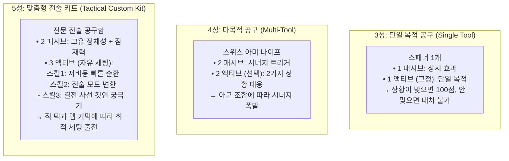

# ⚖️ Checkmate RPG — 성급(5★ / 4★ / 3★) 밸런스 설계 프레임워크 (개정본)

> **문서 버전:** v1.1 (피드백 반영 개정본)  
> **기준 타겟:** Checkmate RPG 전체 캐릭터 및 기물 밸런스 표준  
> **개정 핵심:**  
> 1. **기초 스탯 격차 대폭 압축 (3성 85~90% / 4성 92~95% / 5성 100%):** 스탯 인플레이션 방지 및 체스식 수싸움 보존  
> 2. **성급과 운용 난이도의 분리 (Decoupling):** '국밥형 5성'과 '고난도 3성' 공존 인정  
> 3. **차별화의 핵심을 '스탯'이 아닌 '툴킷(Toolkit)의 유연성과 전술적 완성도'로 전환**  
> **영구 보존 경로:** [Rarity_Balance_Framework.md](file:///c:/Users/VR13/Downloads/20260917/Graduation_Project_v01/Docs/Character_Sheets/Rarity_Balance_Framework.md)  

---

## 1. 개정 밸런스 기조 요약표

| 구분 | ★★★ (3성) — [단일 목적 전문형] | ★★★★ (4성) — [상황 대응 및 시너지형] | ★★★★★ (5성) — [전술적 완성형 / 에이스] |
|:---|:---|:---|:---|
| **설계 정체성** | **Single-Purpose Specialist**<br>(하나의 역할에 극도로 충실한 단일 툴) | **Situational Versatility & Synergy**<br>(상황 적응력과 파티 시너지의 핵심 가교) | **Tactical Autonomy & Ace Impact**<br>(스킬 커스텀 자유도와 압도적 전장 장악력) |
| **기초 스탯 지수** | **85% ~ 90% (기준)** | **92% ~ 95%** | **100% (상한선)** |
| **스탯 격차 체감** | **5성과 스탯 차이 10~15% 내외**<br>(스탯으로 일방적 압살 불가능) | **5성과 대등한 실전 체급**<br>(체급 차이 체감 미미) | **정밀하게 제어된 최고 스탯**<br>(스탯 깡패가 아닌 완성도 우위) |
| **운용 난이도 스펙트럼** | **쉬움 ~ 어려움 공존**<br>(단순 고기방패 폰 ~ 각도 재는 사수) | **보통 ~ 숙련 필요**<br>(원소 반응 타이밍, 위치 조작) | **초단순 국밥형 ~ 고난도 테크니컬형 공존**<br>(무지성 든든한 5성 딜탱부터 극단적 암살자까지) |
| **스킬 툴킷 (Toolkit)** | **1 패시브 + 1 고정 액티브**<br>(선택지 없음, 주어진 역할만 수행) | **2 패시브 + 2 액티브 (선택)**<br>(전황에 따라 2가지 전술 대응) | **2 패시브 + 3 액티브 (자유 선택)**<br>(저비용 순환 / 전술 변환 / **사선 컷인 궁극기**) |
| **메커니즘 차별점** | **단일 룰 충실:** 1가지 목표만 직관적 수행<br>(순수 힐, 순수 넉백, 순수 AP 펌핑) | **조건부 확장:** 파티원 연계 시 고점 폭발<br>(상태이상 트리거, 위치 교환, 장판) | **스킬셋 커스텀 & 독보적 파급력:**<br>상대 덱/기믹에 맞춰 스킬을 바꿔 출전 가능 |

---

## 2. 세부 축 1: 압축된 기초 스탯 밸런스 (Tight Stat Distribution)

### 2.1. 왜 스탯 격차를 10~15% 이내로 압축하는가?
- **체스식 수싸움의 보존:** 체스는 기물의 '위치(Positioning)'와 'AP 효율(Action Economy)'이 핵심입니다. 3성 폰이나 룩이 5성 공격에 한 방에 철거되면, 폰으로 길을 막고 AP를 벌며 반격을 도모하는 전술적 상호작용이 성립할 수 없습니다.
- **P2W 및 파워 인플레이션 방지:** 3성도 제대로 된 전선(탱커/폰) 역할을 수행할 수 있어야 하며, 5성은 '스탯으로 찍어누르는 깡패'가 아니라 '더 정교하고 강력한 툴킷을 쥐고 있는 마스터피스'여야 합니다.

### 2.2. 성급별 기초 스탯 벤치마크 (Lv 1 나이트 기준 실측 비교)

| 기물 스탯 | 3성 나이트 (카일) | 4성 나이트 (가상) | 5성 나이트 (키아라) | 3성 대비 5성 비율 |
|:---|:---:|:---:|:---:|:---:|
| **최대 체력 (HP)** | 620 | 660 | **700** | **+12.9%** |
| **물리 방어력 (DEF)** | 28 | 30 | **32** | **+14.2%** |
| **기본 공격력 (ATK)** | 135 | 145 | **155** | **+14.8%** |
| **마법 저항력 (RES)** | 5% | 5% | **5%** | **0% (동일)** |

> **요약:** 3성과 5성의 스탯 격차는 **15%를 넘지 않도록 철저히 통제**됩니다. 5성의 강력함은 높은 스탯이 아니라, 스킬의 계수, 부가 효과, 그리고 전술적 다변성에서 나옵니다.

---

## 3. 세부 축 2: 성급과 운용 난이도의 분리 (Decoupling)

> **핵심 원칙:** 성급이 난이도를 결정하지 않습니다. 5성에도 누구나 쉽게 쓰는 '국밥형 캐릭터'가 반드시 존재해야 합니다.

```text
[운용 난이도 축]
쉬움 (직관적/국밥형) ◀────────────────────────────▶ 어려움 (테크니컬/조건부)
- 3성: 바론(방패 고기방패), 노아(자동 단일힐)      - 3성: 로빈(ㄱ자 곡사 사수), 클로에(킬캐치 각)
- 4성: 근위대장(인접 방어 오라)                   - 4성: 환영기사(위치 스왑), 지형술사(장판 설계)
- 5성: [국밥형 5성] 브루투스(무지성 돌진 딜탱)       - 5성: [테크니컬 5성] 엘레나(2칸 사각지대 저격)
```

### 3.1. 5성 캐릭터의 2가지 양대 축

1. **[국밥형 5성 (Anchor / Juggernaut)] — "안정성과 압도적 존재감"**
   - **특징:** 복잡한 패널티나 조건부가 없음. 배치해 두는 것만으로도 전선 하나를 완벽하게 틀어막거나 든든하게 아군을 지탱.
   - **예시 구상 (룩 / 수호거신):**
     - 패시브: 상시 받는 피해 25% 감쇄 + 인접 아군이 피격 시 자동으로 가로막아 대신 피격.
     - 액티브 1: 단순하고 묵직한 직선 3칸 넉백 및 방어력 상승.
     - 액티브 3 (컷인): 전장 전열에 거대한 방벽을 세워 아군 전체에게 10초간 무적급 보호막 부여.
   - **플레이 체감:** 초보자도 안심하고 기용할 수 있는 덱의 든든한 대들보.

2. **[스페셜리스트 / 테크니컬 5성 (Specialist / Carry)] — "하이리스크 & 하이포텐셜"**
   - **특징:** 명확한 핸디캡이나 엄격한 거리/조건이 존재하지만, 조건 달성 시 게임을 혼자 끝내는 파괴력.
   - **실제 사례:**
     - **엘레나 (비숍/저격수):** 주변 2칸 사각지대(근접 시 무력화) ↔ 3칸 이상 30% 증폭 및 사선 컷인 적 킹 원거리 암살.
     - **키아라 (나이트/검객):** 2연타로 적 방어력 감산 2회 적용 ↔ 출혈 3타 방무 및 24초간 행동속도 60% 단축 폭딜.
     - **베스타 (룩/공성병기):** 1칸 초근접 공격 불가 ↔ 룩/고방어 적 40% 고정피해 및 넉백 완전 면역.

---

## 4. 세부 축 3: 스킬 툴킷(Toolkit)의 깊이와 유연성 차이

성급의 진짜 가치는 **"상황이 변했을 때 얼마나 유연하게 대응할 수 있는가(Toolbox)"**에서 결정됩니다.



### 4.1. 3성: [단일 목적성 (Specialist Tool)]
- **스킬 구성:** 패시브 1개 + 고정 액티브 1개 (선택 불가).
- **특징:**
  - 바론(방어대)은 '탱킹'만 하고, 노아(사제)는 '힐'만 하며, 레오(척후대)는 'AP 펌핑'만 합니다.
  - 플레이어가 스킬을 바꿀 수 없으므로, 적의 상성에 취약할 수 있지만 자신의 전문 분야에서는 5성 못지않은 효율을 냅니다.

### 4.2. 4성: [상황 대응력 및 시너지 (Versatile Adapter)]
- **스킬 구성:** 패시브 2개 + 2가지 액티브 중 택 1.
- **특징:**
  - 단일 대상 제압용 스킬과 광역 진형 붕괴용 스킬 중 보스의 특성에 맞춰 선택 장착 가능.
  - 파티원의 원소/물리 상태이상(빙결, 출혈, 비틀거림 등)과 맞물릴 때 추가 효과가 격발되어 5성에 필적하는 시너지 창출.

### 4.3. 5성: [전술적 자율성 및 결전 파급력 (Autonomous Master)]
- **스킬 구성:** 패시브 2개 + **3가지 액티브 중 택 1 (자유 교체)** + **전용 사선 컷인 궁극기 보유**.
- **특징:**
  - **스킬 1 (저비용 순환탄, SP 5~10):** 빠른 템포전, 잡몹전 세팅.
  - **스킬 2 (전술 모드 변환, SP 70~80):** 지속 딜링/지속 탱킹이 필요한 장기전 세팅.
  - **스킬 3 (사선 컷인 궁극기, SP 100~120):** 한 방에 적 보스나 핵심 기물을 날려야 하는 결전 세팅.
  - **유저가 맵과 적 구성을 보고 최적의 스킬을 장착하여 출전할 수 있는 완벽한 전술 자율성**을 제공합니다.

---

## 5. 실전 예시: '국밥형 5성' vs '테크니컬 5성' vs '3성 표준'

| 구분 | 3성 표준 룩: 브록 (포트리스) | 국밥형 5성 룩: 아틀라스 (철벽수호자) | 테크니컬 5성 룩: 베스타 (공성병기) |
|:---|:---|:---|:---|
| **기초 스탯 (Lv 1)** | HP 880 / DEF 50 / ATK 135 | HP 980 / DEF 58 / ATK 150 | HP 1,100 / DEF 55 / ATK 210 |
| **운용 난이도** | **쉬움 (★☆☆☆☆)** | **매우 쉬움 (★☆☆☆☆, 무지성 국밥)** | **어려움 (★★★★☆, 사각지대/거리 계산)** |
| **핵심 기믹** | 단순 물리 방어 + 2칸 넉백 | **상시 피해 25% 감쇄 + 인접 아군 대리 가드** | **2칸 이상 타격 + 적 룩/고방어 40% 트루뎀** |
| **패시브 구성** | [단일] 받는 물리 피해 -8 추가 감산 | [패시브 1] 전열 가드 (아군 피격 시 대신 피격)<br>[패시브 2] 피격 시마다 자신의 방어력 +2 (최대 30) | [패시브 1] 룩/보스 추뎀 35% + SP 2초 동결<br>[패시브 2] 첫 30초 피해 20% 감쇄 + 넉백 면역 |
| **액티브 선택지** | **1개 고정** (SP 50)<br>전방 1칸 적 160% 피해 + 2칸 넉백 | **3개 택 1 (자유 세팅)**<br>① SP 8: 전방 가로 3칸 적 동시 넉백<br>② SP 75: 15초간 자신 방어력 100% 폭증<br>③ **SP 100 (컷인): 전장 전열에 철벽 방벽 소환** | **3개 택 1 (자유 세팅)**<br>① SP 8: 3칸 넉백 + 방깎 30%<br>② SP 80: 앵커 고정 십자 광역 포격<br>③ **SP 110 (컷인): 전방 경로 궤도 관통 빔** |
| **전술적 차별성** | 든든하게 1인분 탱킹을 수행 | **어떤 덱에 넣어도 무지성으로 전선을 완벽 수호** | **적 룩이나 떡장갑 보스를 저격 분쇄하는 조커** |

---

## 6. 결론: 기획팀 가이드라인 요약

1. **스탯으로 차별화하지 말 것:** 3성과 5성의 스탯 격차는 **10~15% 수준으로 억제**하여 체스 기물 본연의 위치와 AP 가치를 지킬 것.
2. **5성을 무조건 어렵게 만들지 말 것:** 유저가 편하게 기용할 수 있는 **'국밥형 5성'**과 전략적 깊이를 주는 **'테크니컬 5성'**을 균형 있게 공존시킬 것.
3. **5성의 진정한 보상은 '툴킷의 자유도(3-Choice Actives)와 궁극기 컷인의 연출적 쾌감':** 적에 따라 스킬을 스위칭하는 유연함이 5성의 핵심 가치임.
