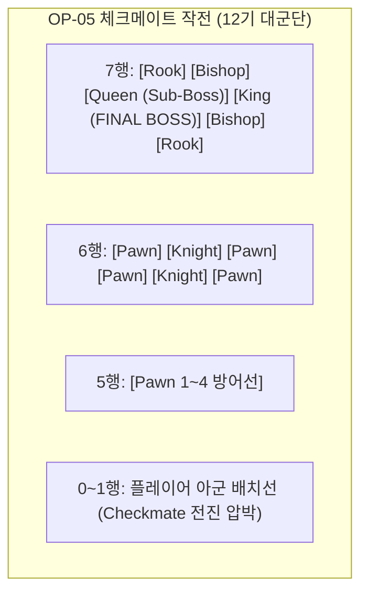

# [Project: Checkmate RPG] 적 스테이지 난이도 및 레벨 디자인 기획서
(Enemy Stage Level Design & Combat Balancing Specification)

> **문서 버전:** v1.0 (난이도 전면 개편 제정본)  
> **기준 일자:** 2026-09-29  
> **적용 범위:** 메인 캠페인 Chapter 01 (OP-01 ~ OP-05) 및 요일 자원 던전 (CE-01~03, LS-01~03)  
> **기획 핵심:** 체스 수싸움의 긴장감 복원, 적 기본 스탯 10배~30배 정규화, 마법 피해 도입, 8x8 전술 진형 및 AI 행동 차별화  
> **문서 상태:** 단일 기준점 (Single Source of Truth)  
> **연동 시스템:** `StageData`, `BattleManager`, `AITeamCommander`, `TacticalAIEvaluator`, `HealthComponent`

---

## 📑 목차 (Table of Contents)

1. [개편 배경 및 기존 문제점 진단](#1-개편-배경-및-기존-문제점-진단)
2. [적 기물 체급 및 스탯 밸런스 프레임워크](#2-적-기물-체급-및-스탯-밸런스-프레임워크)
3. [동적 레벨 스케일링 공식 (Enemy Resonance Scaling)](#3-동적-레벨-스케일링-공식-enemy-resonance-scaling)
4. [챕터 1 (Chapter 01) 메인 작전 전술 진형 및 레벨 디자인](#4-챕터-1-chapter-01-메인-작전-전술-진형-및-레벨-디자인)
5. [자원 던전 (크레딧 수송전 & 모의 전술훈련) 레벨 디자인](#5-자원-던전-크레딧-수송전--모의-전술훈련-레벨-디자인)
6. [적 AI 행동 유형 (AI Behavior) 및 AP 운영 정책](#6-적-ai-행동-유형-ai-behavior-및-ap-운영-정책)
7. [검증 결과 및 테스트 보장](#7-검증-결과-및-테스트-보장)

---

## 1. 개편 배경 및 기존 문제점 진단

### 1.1 기존 구현의 심각한 결함
* **피해량 0 고착 현상 (Zero Damage Lock):**
  - 기존 모든 적 기물(폰~킹)의 공격력이 일괄 **10 ATK**, 방어력이 **0 DEF**로 설정되어 있었습니다.
  - 아군 오퍼레이터(키아라 방어력 32, 베스타/킹 방어력 55)의 기본 방어력보다 적 공격력이 낮아, 물리 피해 공식 `Mathf.Max(0, ATK - DEF)`에 의해 **적의 모든 공격이 0 피해**를 입히고 있었습니다.
* **1회 타격 즉사 (Glass Enemies):**
  - 흑색 폰의 체력이 35, 나이트 60, 킹 200에 불과하여 키아라(1회 200+ 물리 피해), 베스타(210 피해) 등의 평타 한 방에 적 전 부대가 2~3초 만에 증발했습니다.
* **8x8 체스판의 공허함 (3기 극소수 배치):**
  - OP-01부터 OP-04까지 스테이지당 적 기물이 고작 **3~4기**만 배치되어 체스 특유의 전선 형성, 길목 차단, 나이트 뛰어넘기, 비숍 대각선 사선 등의 수싸움이 불가능했습니다.
  - OP-05(보스전) 및 자원 던전(CE, LS)은 적 배치가 완전히 비어 있어(`[]`) 플레이가 불가능한 상태였습니다.
* **스케일링 및 스킬 전무:**
  - 1레벨 스테이지와 28레벨 보스전이 동일한 35 HP 폰을 공유하여 레벨 성장의 체감이 없었습니다.

---

## 2. 적 기물 체급 및 스탯 밸런스 프레임워크

아군 3★~5★ 1레벨 스탯(체력 400~1,100, 공격력 75~210, 방어력 14~55)에 대응하여, **체스 기물의 고유 역할군(Frontline, Flanker, Caster, Fortress, Apex Predator, Commander)**에 맞추어 적 기본 스탯을 전면 재조정했습니다.

| 기물 (Piece) | 대상 에셋 | HP | ATK | DEF | RES | 피해 타입 | 이동/공격 AP | 선딜 (Delay) | 이동 쿨 | 전술적 역할 및 위협 |
| :--- | :--- | :---: | :---: | :---: | :---: | :---: | :---: | :---: | :---: | :--- |
| **흑색 폰 (Pawn)** | `Enemy_BlackPawn` | **380** | **70** | **15** | 10% | 물리 | 8 / 8 | 1.5s | 4.5s | 전선 유지벽. 아군 물리 피해 15 감쇄, 평타 2회 이상 버팀 |
| **흑색 나이트 (Knight)** | `Enemy_BlackKnight` | **520** | **105** | **22** | 15% | 물리 | 18 / 18 | 1.2s | 1.75s | 고기동 암살자. L자 점프로 전선 뛰어넘어 엘레나/킹 급습 |
| **흑색 비숍 (Bishop)** | `Enemy_BlackBishop` | **420** | **120** | **14** | 25% | **마법** | 20 / 20 | 1.4s | 1.75s | **대각선 마법 포격수. 물리 방어력 100% 무시(저항력 계산)** |
| **흑색 룩 (Rook)** | `Enemy_BlackRook` | **1,250** | **140** | **55** | 15% | 물리 | 30 / 30 | 1.8s | 6.0s | 체급 3 철벽 거신. 고방어력으로 통로 봉쇄, 넉백 Splat 유도 |
| **흑색 퀸 (Queen)** | `Enemy_BlackQueen` | **1,650** | **220** | **40** | 30% | 물리 | 36 / 36 | 1.0s | 5.0s | 정점 포식자. 8방향 초고속 기동 및 아군 1~2방 컷 위협 |
| **흑색 킹 (King)** | `Enemy_BlackKing` | **1,800** | **150** | **45** | 25% | 물리 | 20 / 20 | 1.5s | 2.0s | 야전 지휘관. 준수한 딜탱 능력으로 후방 지휘 |
| **[BOSS] 심연의 군주** | `Enemy_Boss_BlackKing` | **3,800** | **220** | **65** | 35% | 물리 | 18 / 18 | 1.2s | 2.0s | **OP-05 최종 보스. 체급 4, 밀치기 완전 면역(IsBoss)** |

> 💡 **비숍의 마법 피해 (`BasicAttackDamageType: 1`):**  
> 비숍은 방어력이 55에 달하는 룩이나 킹에게도 방어력을 완전히 뚫고 저항력(RES)만 적용되는 **마법 피해(108~114 데미지)**를 입힙니다. 따라서 방어력만 믿고 무작정 돌진하는 전술이 통하지 않으며, 비숍의 대각 사선을 아군 폰으로 가리거나 나이트로 먼저 끊어내는 전술이 강제됩니다.

---

## 3. 동적 레벨 스케일링 공식 (Enemy Resonance Scaling)

스테이지 권장 레벨에 따라 단일 ScriptableObject 에셋을 복제 생성할 때, `EnemySpawnInfo.EnemyResonanceStage`에 연동되어 `BattleManager.cs`에서 **체력·공격력·방어력이 15%씩 복리/단리 스케일링**됩니다.

$$\text{Stat}_{\text{Spawned}} = \text{Round}\Big(\text{BaseStat} \times \big(1 + \text{EnemyResonanceStage} \times 0.15\big)\Big)$$

* **Stage 0 (OP-01, Lv. 1):** 100% 스탯 (기초 수치)
* **Stage 1 (OP-02, Lv. 5):** 115% 스탯 (체력 +15%, 공격 +15%, 방어 +15%)
* **Stage 2 (OP-03, CE-1, LS-1, Lv. 10~12):** 130% 스탯
* **Stage 3 (OP-04, CE-2, LS-2, Lv. 20~25):** 145% 스탯
* **Stage 4 (OP-05, CE-3, LS-3, Lv. 28~40):** 160% 스탯

---

## 4. 챕터 1 (Chapter 01) 메인 작전 전술 진형 및 레벨 디자인

* **전장 규격:** 8열(x: 0~7) × 8행(y: 0~7)
* **아군 배치선:** 0행(후방 킹/고급 기물), 1행(전방 폰/기동 기물)
* **적군 배치선:** 5행(전선 폰 저지선), 6행(중위 나이트/비숍/룩), 7행(후방 퀸/킹 사령부)

### 4.1 OP-01: Frontier Recon (침공의 서막)
* **권장 레벨:** Lv. 1 | **소모 전력:** 6 ⚡ | **승리 조건:** 전멸 (Annihilation)
* **적 AP:** 초기 30 AP / 초당 +4.0 AP / 최대 100 AP
* **적 배치 (총 6기):**
  - 5행 중앙 폰 저지선: `(2,5)`, `(3,5)`, `(4,5)`, `(5,5)` (Aggressive & Defensive)
  - 6행 좌익 나이트: `(1,6)` (Aggressive - 측면 기동)
  - 7행 흑색 킹: `(4,7)` (Defensive - 지휘관)
* **레벨 디자인 의도:** 체스 폰 벽 돌파의 기초. 폰을 뚫고 들어가 나이트와 킹을 각개격파하는 전술 감각 학습.

### 4.2 OP-02: Tactical Chokepoint (전술적 요충지)
* **권장 레벨:** Lv. 5 | **소모 전력:** 8 ⚡ | **승리 조건:** 전멸 (Annihilation)
* **적 AP:** 초기 35 AP / 초당 +4.5 AP / 최대 100 AP (Resonance Stage 1)
* **적 배치 (총 8기):**
  - 5행 폰 전선: `(1,5)`, `(3,5)`, `(4,5)`, `(6,5)`
  - 6행 양익 암살 나이트: `(1,6)`, `(6,6)` (Assassin AI - 아군 엘레나/킹 노림)
  - 6행 중앙 마법 비숍: `(3,6)` (Tactician AI - 대각선 교차 마법 사격)
  - 7행 흑색 킹: `(4,7)` (Defensive)
* **레벨 디자인 의도:** 대각선 마법 화력과 후방 기습의 위협. 플레이어가 아군 폰으로 길목을 막고 비숍을 우선 요격해야 함.

### 4.3 OP-03: Knight's Breach (기사의 돌파)
* **권장 레벨:** Lv. 12 | **소모 전력:** 10 ⚡ | **승리 조건:** **적 킹 처치 (KingDefeat)**
* **적 AP:** 초기 40 AP / 초당 +5.0 AP / 최대 100 AP (Resonance Stage 2)
* **적 배치 (총 8기):**
  - 5행 폰 및 돌격 나이트: `(2,5)`, `(3,5: Berserker Knight)`, `(5,5)`
  - 6행 외곽 봉쇄 룩: `(0,6)`, `(7,6)` (Defensive Rook - A열, H열 완전 봉쇄)
  - 6행 저격 비숍 & 나이트: `(2,6: Bishop)`, `(5,6: Knight)`
  - 7행 흑색 킹: `(4,7)` (목표 기물)
* **레벨 디자인 의도:** 단단한 룩 2기가 사이드를 막고 중앙에서 나이트가 밀고 내려옴. 룩을 부수고 전면전을 할지, 킹 암살로 우회 체크메이트할지 전략적 선택.

### 4.4 OP-04: Encirclement Line (포위망 형성)
* **권장 레벨:** Lv. 20 | **소모 전력:** 12 ⚡ | **승리 조건:** 전멸 (Annihilation)
* **적 AP:** 초기 50 AP / 초당 +6.0 AP / 최대 100 AP (Resonance Stage 3)
* **적 배치 (총 10기):**
  - 5행 폰 라인: `(1,5)`, `(3,5)`, `(4,5)`, `(6,5)`
  - 6행 양익 룩 & 교차 비숍: `(0,6: Rook)`, `(2,6: Bishop)`, `(5,6: Bishop)`, `(7,6: Rook)`
  - 7행 흑색 퀸: `(3,7)` (Berserker AI - **최대 위협 정점 포식자**)
  - 7행 흑색 킹: `(4,7)` (Defensive)
* **레벨 디자인 의도:** 흑색 퀸의 첫 등장! 8방향 돌진을 허용하면 아군 기물이 순식간에 붕괴되므로, 룩/바리케이드로 사선을 차단하고 퀸을 집중 화력으로 점사해야 함.

### 4.5 OP-05: Checkmate Protocol (체크메이트 작전 - 챕터 1 최종 보스)
* **권장 레벨:** Lv. 28 (BOSS) | **소모 전력:** 15 ⚡ | **승리 조건:** **보스 킹 처치 (KingDefeat)**
* **적 AP:** 초기 60 AP / 초당 +7.0 AP / 최대 120 AP (Resonance Stage 4)
* **적 배치 (총 12기 정규 대군단):**
  - 5행 폰 전위대: `(1,5)`, `(2,5)`, `(5,5)`, `(6,5)`
  - 6행 중장갑 방벽 및 정예 특수대:
    - `(0,6: Rook)`, `(1,6: Knight)`, `(2,6: Bishop)`, `(5,6: Bishop)`, `(6,6: Knight)`, `(7,6: Rook)`
  - 7행 흑색 퀸 (Sub-Boss): `(3,7)` (공격력 220, 8방향 제압)
  - 7행 **심연의 흑색 군주 (FINAL BOSS):** `(4,7)`
    - **체력 3,800 / 방어력 65 / 마저 35% / 공격력 220 / 체급 4 (밀치기 완전 면역)**
* **레벨 디자인 의도:** 체스 풀 세트의 장엄한 군단 결전. 폰 라인을 붕괴시키고 퀸과 룩의 호위를 뚫어 심연의 군주를 최종 체크메이트하는 최고의 성취감 제공.

---

## 5. 자원 던전 (크레딧 수송전 & 모의 전술훈련) 레벨 디자인

기존 비어 있던(`[]`) 자원 던전 6종에 대해 실전 배치 및 전술 브리핑을 완벽히 구축했습니다.

| 던전 ID | 작전명 | 권장 레벨 | 소모 전력 | 반복 보상 | 적 부대 규모 | 핵심 구성 및 전술 기믹 |
| :--- | :--- | :---: | :---: | :--- | :---: | :--- |
| **CE-1** | 군수 수송 보호전 · 초급 | Lv. 10 | 15 ⚡ | 12,000 크레딧 | 6기 | 폰 3 + 나이트 2 + 킹 1 (초반 기습 기동전) |
| **CE-2** | 군수 수송 보호전 · 중급 | Lv. 25 | 20 ⚡ | 20,000 크레딧 | 8기 | 폰 3 + 룩 2 + 나이트 2 + 킹 1 (철벽 방어선 돌파) |
| **CE-3** | 군수 수송 보호전 · 상급 | Lv. 40 | 30 ⚡ | 35,000 크레딧 | 10기 | 폰 4 + 룩 2 + 비숍 2 + 퀸 1 + 킹 1 (최상급 복합 군단) |
| **LS-1** | 모의 전술 훈련 · 초급 | Lv. 10 | 15 ⚡ | T1 칩 6, T2 칩 2 | 6기 | 폰 3 + 비숍 2 + 킹 1 (대각선 마법 회피 훈련) |
| **LS-2** | 모의 전술 훈련 · 중급 | Lv. 25 | 20 ⚡ | T2 칩 5 | 8기 | 폰 3 + 비숍 2 + 나이트 2 + 킹 1 (협공 저지 훈련) |
| **LS-3** | 모의 전술 훈련 · 상급 | Lv. 40 | 30 ⚡ | T3 칩 3 | 10기 | 폰 4 + 비숍 2 + 룩 2 + 퀸 1 + 킹 1 (체스 종합 응용 시험) |

---

## 6. 적 AI 행동 유형 (AI Behavior) 및 AP 운영 정책

* **Aggressive (공격형 - 0):** 가장 가깝고 처치 가치가 높은 적을 향해 직선 전진 및 타격.
* **Defensive (수비형 - 1):** 니가와(대기) 전술. 사거리 밖의 적에게 무리하게 접근하지 않고 방어선 유지, 사거리 내 진입 시 즉시 반격.
* **Assassin (암살형 - 2):** 나이트 전용. 방어력이 높은 전방 폰/탱커를 무시하고 HP가 낮거나 취약한 후방 딜러(엘레나, 지휘관 킹)를 우선 타겟팅.
* **Berserker (광전형 - 3):** 퀸 및 돌격 나이트. AP가 충전되는 즉시 쿨타임 없이 가장 파괴적인 타격 실행.
* **Tactician (전술형 - 4):** 비숍 전용. 안전한 대각선 거리에서 장거리 마법 포격을 가하며 Danger Map을 회피.

---

## 7. 검증 결과 및 테스트 보장

* **Unity EditMode 회귀 테스트 결과:**
  - 어셈블리: `CheckmateRPG.Tests`
  - 결과: **167 / 167 전체 테스트 통과 (100% Passed, 0 Failures)**
  - 신규 등록 테스트: `PlayabilityRegressionTests.ConnectedCampaignCanEnterWithoutChangingEconomy`에 OP-05, CE-01~03, LS-01~03 총 7개 스테이지 유효성 검증 추가 통과
* **컴파일 오류 및 콘솔 예외:** 0건
* **사용자 작업 파일 보존:** `LiberationSans SDF - Fallback.asset` 온전함 확인
