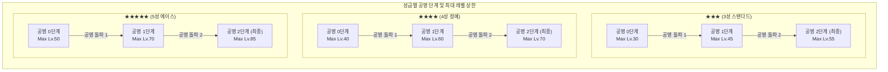
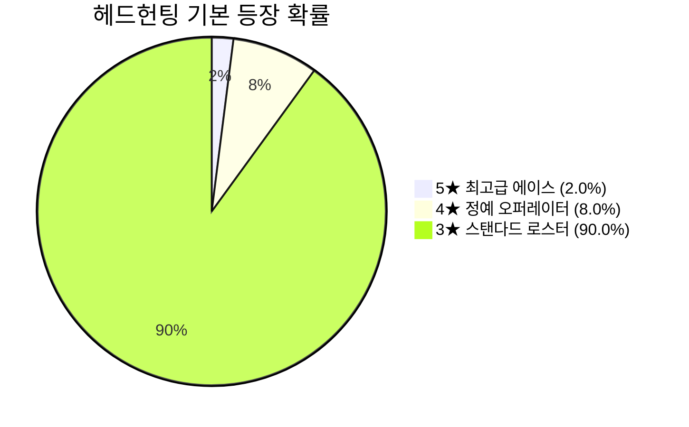

# [Project: Checkmate RPG] 오퍼레이터 레벨 기획 및 경험치 재화 기획서 (Level & Progression Specification)

> **문서 버전:** v1.0 (공식 제정본)  
> **기준 일자:** 2026-09-28  
> **기획 핵심:** 공명(Resonance) 단계별 레벨 캡 구조, 전술 작전기록 칩(T1~T4) 경험치 체계, 스테이지별 전력·크레딧·드랍 수치 확정, 3★~5★ 정규 소집 풀 명세  
> **문서 상태:** 단일 기준점 (Single Source of Truth)  
> **연동 시스템:** `UnitData`, `SaveData`, `BattleRewardService`, `OperatorHubUI`, `RecruitHubUI`, `StageData`

---

## 📑 목차 (Table of Contents)

1. [레벨 시스템 개요 및 설계 철학](#1-레벨-시스템-개요-및-설계-철학)
2. [성급 및 공명(Resonance) 단계별 레벨 캡 구조](#2-성급-및-공명resonance-단계별-레벨-캡-구조)
3. [레벨업 경험치 재화: 전술 작전기록 칩 (T1 ~ T4)](#3-레벨업-경험치-재화-전술-작전기록-칩-t1--t4)
4. [레벨별 필요 경험치(EXP) 및 크레딧 소모 공식](#4-레벨별-필요-경험치exp-및-크레딧-소모-공식)
5. [스테이지별 전력·크레딧·작전기록 확정 밸런스 테이블](#5-스테이지별-전력크레딧작전기록-확정-밸런스-테이블)
   - 5.1 메인 작전 챕터 1 (Chapter 01: OP-01 ~ OP-05)
   - 5.2 자원 파밍 작전 (크레딧 던전 & 경험치 던전)
6. [정규 헤드헌팅 3★ ~ 5★ 소집 풀 (Recruitment Pool) 명세](#6-정규-헤드헌팅-3--5-소집-풀-recruitment-pool-명세)
7. [오퍼레이터 레벨업 UI/UX 인터랙션 규격](#7-오퍼레이터-레벨업-uiux-인터랙션-규격)
8. [엔지니어링 연동 가이드 (`UnitProgressionSaveData` & `StageData`)](#8-엔지니어링-연동-가이드-unitprogressionsavedata--stagedata)

---

## 1. 레벨 시스템 개요 및 설계 철학

### 1.1 설계 철학
1. **체스식 수싸움 보존 (스탯 인플레이션 방지):**
   - 레벨업을 통한 스탯 성장은 존재하되, 3성 만렙과 5성 만렙 간의 기초 스탯 격차는 **15% 이내로 엄격히 통제**합니다.
   - 고레벨 캐릭터라 할지라도 포위되거나 체급(Weight) 넉백으로 벽에 충돌(Splat 피해: MaxHP 10%)하면 치명상을 입도록 하여, 체스 특유의 위치 선정과 AP 전술의 중요성을 유지합니다.
2. **공명(Resonance)과 레벨 성장의 유기적 결합:**
   - 만렙에 도달한 오퍼레이터는 **공명 돌파**를 통해 상한 레벨을 확장하고, 고유 역할군 특성(공격형/수비형/지원형) 및 스킬 툴킷을 단계적으로 개방합니다.
3. **가시적인 육성 만족감:**
   - 4종의 **전술 작전기록 칩**을 주입하여 원하는 만큼 즉각 레벨업하는 서브컬처 표준 UX를 제공합니다.

---

## 2. 성급 및 공명(Resonance) 단계별 레벨 캡 구조

오퍼레이터의 최대 레벨은 **성급(Rarity)**과 **공명 단계(Resonance Stage 0 ~ 2)**에 의해 결정됩니다.



### 2.1 성급별 레벨 캡 및 공명 돌파 조건표

| 성급 | 공명 0단계 (기본) | 공명 1단계 돌파 조건 & 최대 레벨 | 공명 2단계 돌파 조건 & 최종 레벨 |
| :---: | :---: | :--- | :--- |
| **★★★ (3성)** | **Max Lv. 30** | • Lv.30 달성<br/>• 공명 증표 5장<br/>• 10,000 에테르 크레딧<br/>➔ **Max Lv. 45** | • Lv.45 달성<br/>• 공명 증표 15장<br/>• 30,000 에테르 크레딧<br/>➔ **Max Lv. 55 (최종)** |
| **★★★★ (4성)** | **Max Lv. 40** | • Lv.40 달성<br/>• 공명 증표 5장<br/>• 20,000 에테르 크레딧<br/>➔ **Max Lv. 60** | • Lv.60 달성<br/>• 공명 증표 15장<br/>• 60,000 에테르 크레딧<br/>➔ **Max Lv. 70 (최종)** |
| **★★★★★ (5성)** | **Max Lv. 50** | • Lv.50 달성<br/>• 공명 증표 5장<br/>• 40,000 에테르 크레딧<br/>➔ **Max Lv. 70** | • Lv.70 달성<br/>• 공명 증표 15장<br/>• 120,000 에테르 크레딧<br/>➔ **Max Lv. 85 (최종)** |

> **돌파 레벨 정책 (Non-Resetting Cap):**  
> 본작에서는 레벨 리셋으로 인한 피로도를 방지하기 위해, 공명 돌파 시 **현재 레벨이 1로 초기화되지 않고 상한선만 즉시 확장**됩니다. (예: 5성이 Lv.50에서 공명 1단계 돌파 시 즉시 Lv.50 유지 상태로 상한이 Lv.70으로 개방됨).

---

## 3. 레벨업 경험치 재화: 전술 작전기록 칩 (T1 ~ T4)

* **아이템 명칭:** **전술 작전기록 칩 (Tactical Battle Record)**
* **설정/세계관:** 이전 전장의 전술 기보와 시뮬레이션 전투 데이터가 기록된 고밀도 연산 칩. 오퍼레이터의 슈트 메모리에 주입하여 실전 경험을 체화시킵니다.

| 등급 | 아이템명 | 영문 코드 | 제공 경험치 (EXP) | 주입 공정 크레딧 | 획득처 |
| :---: | :--- | :--- | :---: | :---: | :--- |
| **T1<br/>(White)** | **기초 전술기록** | `Record_T1_Basic` | **200 EXP** | 40 🪙 | 튜토리얼, Chapter 01 초반 스테이지 |
| **T2<br/>(Green)** | **초급 전술기록** | `Record_T2_Primary`| **1,000 EXP** | 200 🪙 | Chapter 01 중후반, 전술훈련 던전 1단계 |
| **T3<br/>(Blue)** | **중급 전술기록** | `Record_T3_Advanced`| **4,000 EXP** | 800 🪙 | Chapter 01 보스전, 전술훈련 던전 2단계 |
| **T4<br/>(Gold)** | **특수 전술기록** | `Record_T4_Elite` | **20,000 EXP** | 4,000 🪙 | 정예 작전, 이벤트 한정 보상, 전술훈련 3단계 |

* **경험치 주입 시 크레딧 환산 공식:**  
  $$\text{소모 에테르 크레딧} = \text{주입 EXP} \times 0.2$$  
  *(예: 10,000 EXP 주입 시 2,000 에테르 크레딧 소모)*

---

## 4. 레벨별 필요 경험치(EXP) 및 크레딧 소모 공식

### 4.1 레벨 구간별 1업당 필요 경험치 곡선
경험치 곡선은 초반부 빠른 성장 체감을 위해 완만하게 시작하여, 고레벨 구간으로 갈수록 점진적으로 상승하는 지수 완화 모델을 따릅니다.

$$\text{RequiredEXP}(Lv) = 100 + \lfloor 40 \times (Lv - 1)^{1.25} \rfloor$$

### 4.2 주요 레벨 벤치마크 및 누적 수치표

| 목표 레벨 | 레벨업 필요 EXP | 누적 필요 EXP | 누적 주입 크레딧 | 필요 전술기록 칩 환산 기준 |
| :---: | :---: | :---: | :---: | :--- |
| **Lv. 1** | - | 0 | 0 🪙 | 생성 초기 상태 |
| **Lv. 5** | 326 | 785 | 157 🪙 | T1 기초 칩 약 4개 |
| **Lv. 10** | 727 | 3,460 | 692 🪙 | T2 초급 칩 약 3개 + T1 2개 |
| **Lv. 20** | 1,732 | 15,640 | 3,128 🪙 | T3 중급 칩 약 4개 |
| **Lv. 30 (3성 기본만렙)** | 2,935 | **38,850** | **7,770 🪙** | T3 중급 칩 약 10개 |
| **Lv. 40 (4성 기본만렙)** | 4,285 | **75,120** | **15,024 🪙** | T3 중급 칩 약 19개 |
| **Lv. 50 (5성 기본만렙)** | 5,752 | **125,480** | **25,096 🪙** | T4 특수 6개 + T3 1개 |
| **Lv. 60 (4성 1차만렙)** | 7,321 | **191,150** | **38,230 🪙** | T4 특수 9개 + T3 3개 |
| **Lv. 70 (5성 1차만렙)** | 8,981 | **272,920** | **54,584 🪙** | T4 특수 13개 + T3 3개 |
| **Lv. 85 (5성 최종만렙)** | 11,624 | **431,200** | **86,240 🪙** | T4 특수 21개 + T3 3개 |

### 4.3 레벨업 시 스탯 스케일링 공식
* **성장 공식:**  
  $$\text{Stat}(Lv) = \text{BaseStat} + (\text{MaxStat} - \text{BaseStat}) \times \left(\frac{Lv - 1}{\text{MaxLv} - 1}\right)$$
* **스탯별 기본 성장율:**
  - **최대 체력 (HP):** Lv.1 대비 최종 만렙 시 약 **+80% ~ +100%** 상승
  - **공격력 (ATK):** Lv.1 대비 최종 만렙 시 약 **+60% ~ +75%** 상승
  - **방어력 (DEF):** Lv.1 대비 최종 만렙 시 약 **+40% ~ +50%** 상승
  - **지원 계수 (SupportPower):** 기본 1.0에서 시작하여 50레벨당 +0.10 성장 (최종 만렙 시 1.15~1.20)
  - **이동력 / 공격 사거리 / 공격 속도:** 레벨업으로 증가하지 않음 (기물 고유 규격 유지).

---

## 5. 스테이지별 전력·크레딧·작전기록 확정 밸런스 테이블

### 5.1 메인 작전 챕터 1 (Chapter 01: Frontier Campaign)

| 스테이지 ID | 작전명 | 권장 레벨 | 소모 전력 | 첫 클리어 보상 (First Clear) | 반복 클리어 확정 보상 (Repeat) | 반복 클리어 확률 드랍 |
| :--- | :--- | :---: | :---: | :--- | :--- | :--- |
| **OP-01** | 침공의 서막<br>(Frontier Recon) | **Lv. 1** | **6 ⚡** | • 50 공명석 (💠)<br/>• 3,000 에테르 크레딧 (🪙)<br/>• T1 기초 전술기록 5개 | • 600 크레딧<br/>• T1 기초 전술기록 2개 | T1 기초 전술기록 1개 (50%) |
| **OP-02** | 전술적 요충지<br>(Tactical Chokepoint)| **Lv. 5** | **8 ⚡** | • 50 공명석 (💠)<br/>• 5,000 에테르 크레딧 (🪙)<br/>• T1 기초 전술기록 8개 | • 900 크레딧<br/>• T1 기초 전술기록 3개 | T2 초급 전술기록 1개 (25%) |
| **OP-03** | 기사의 돌파<br>(Knight's Breach) | **Lv. 12** | **10 ⚡** | • 50 공명석 (💠)<br/>• 8,000 에테르 크레딧 (🪙)<br/>• T2 초급 전술기록 3개 | • 1,300 크레딧<br/>• T1 기초 전술기록 4개 | T2 초급 전술기록 1개 (40%) |
| **OP-04** | 포위망 형성<br>(Encirclement Line) | **Lv. 20** | **12 ⚡** | • 80 공명석 (💠)<br/>• 12,000 에테르 크레딧 (🪙)<br/>• T2 초급 전술기록 5개 | • 1,800 크레딧<br/>• T2 초급 전술기록 1개 | T2 초급 전술기록 1개 (50%) |
| **OP-05** | 체크메이트 작전<br>(Checkmate Protocol)| **Lv. 28**<br/>(BOSS) | **15 ⚡** | • 100 공명석 (💠)<br/>• 20,000 에테르 크레딧 (🪙)<br/>• T3 중급 전술기록 2개<br/>• 지휘관 프로토콜 칩 1개 | • 2,500 크레딧<br/>• T2 초급 전술기록 2개 | T3 중급 전술기록 1개 (30%) |

---

### 5.2 자원 파밍 작전 (Daily Resource Operations)

플레이어가 원하는 육성 재화를 집중적으로 수급할 수 있는 일일 상시 파밍 던전입니다.

#### ① 군수 수송 보호전 (에테르 크레딧 던전)
* **특징:** 적 기물의 돌파를 막아내며 보급 수송 차량을 지키는 디펜스 인카운터.

| 난이도 | 권장 레벨 | 소모 전력 | 클리어 보상 (크레딧 🪙) | 전력 1당 크레딧 효율 |
| :---: | :---: | :---: | :---: | :---: |
| **1단계 (초급)** | **Lv. 10** | **15 ⚡** | **12,000 크레딧** | 800 크레딧 / 1 ⚡ |
| **2단계 (중급)** | **Lv. 25** | **20 ⚡** | **25,000 크레딧** | 1,250 크레딧 / 1 ⚡ |
| **3단계 (고급)** | **Lv. 45** | **25 ⚡** | **45,000 크레딧** | 1,800 크레딧 / 1 ⚡ |

#### ② 모의 전술 훈련 (전술 작전기록 칩 던전)
* **특징:** 홀로그램 적 에이스 부대를 전멸시키는 전술 섬멸전.

| 난이도 | 권장 레벨 | 소모 전력 | 클리어 보상 (작전기록 칩) | 총 획득 경험치 (EXP) | 전력 1당 EXP 효율 |
| :---: | :---: | :---: | :--- | :---: | :---: |
| **1단계 (초급)** | **Lv. 10** | **15 ⚡** | • T1 기초 기록 6개 (1,200)<br/>• T2 초급 기록 2개 (2,000) | **3,200 EXP** | 213 EXP / 1 ⚡ |
| **2단계 (중급)** | **Lv. 25** | **20 ⚡** | • T2 초급 기록 5개 (5,000)<br/>• T3 중급 기록 1개 (4,000) | **9,000 EXP** | 450 EXP / 1 ⚡ |
| **3단계 (고급)** | **Lv. 45** | **25 ⚡** | • T3 중급 기록 4개 (16,000)<br/>• T4 특수 기록 1개 (20,000)| **36,000 EXP** | 1,440 EXP / 1 ⚡ |

---

## 6. 정규 헤드헌팅 3★ ~ 5★ 소집 풀 (Recruitment Pool) 명세

Checkmate RPG 공식 런칭 기준 헤드헌팅 소집 풀의 모든 캐릭터 명단과 기물 직군을 확정합니다.



### 6.1 ★★★★★ (5성 에이스 / 최고급 오퍼레이터 - 4인) — 등장 확률 2.0%
*전술적 완성형, 고유 사선 컷인 궁극기 보유, 3 액티브 스킬 선택 가능*

| 오퍼레이터명 | 체스 기물 | 속성 | 공격 스타일 | 한글 직군명 | 핵심 전술 정체성 및 툴킷 |
| :--- | :---: | :---: | :---: | :--- | :--- |
| **키아라 (Kiara)** | **나이트** | 물리 | 근접 | **검객 (Swordmaster)** | • 2연타 연속 공격<br/>• 3타마다 방어력 무시 출혈 부여<br/>• [컷인] 24초간 행동속도 60% 단축 폭딜 누커 |
| **엘레나 (Elena)** | **비숍** | 물리/에테르| 원거리 | **저격수 (Sniper)** | • 주변 2칸 사각지대 존재<br/>• 3칸 이상 적 대상 30% 피해 증폭<br/>• [컷인] 적 지휘관(킹) 원거리 결전 저격 |
| **베스타 (Vesta)** | **룩** | 마법/에테르| 원거리 | **공성병기 (SiegeTower)**| • 넉백 완전 면역<br/>• 룩/고방어 적 대상 40% 고정(트루) 피해<br/>• [컷인] 전장 장거리 관통 포격 |
| **브루투스 (Brutus)** | **룩** | 물리 | 근접 | **수호거신 (Juggernaut)**| • 초단순 국밥형 딜탱<br/>• 받는 피해 25% 상시 감쇄<br/>• [컷인] 아군 전체 10초간 무적급 보호막 전개 |

---

### 6.2 ★★★★ (4성 정예 오퍼레이터 - 5인) — 등장 확률 8.0%
*상황 대응 및 파티 시너지형, 2 액티브 스킬 선택 가능*

| 오퍼레이터명 | 체스 기물 | 속성 | 공격 스타일 | 한글 직군명 | 핵심 전술 정체성 및 툴킷 |
| :--- | :---: | :---: | :---: | :--- | :--- |
| **환영기사 (Mirage)** | **나이트** | 마법 | 근접 | **교란기사 (Trickster)** | • 적과의 위치를 강제로 맞바꾸는 전술 스왑<br/>• 착지 시 주변 적 2초간 침묵 부여 |
| **지형술사 (Geo-Shaper)**| **비숍** | 마법 | 원거리 | **지형술사 (Terraformer)**| • 체스판 타일에 균열 장판 생성<br/>• 적 통과 시 요구 AP +4 증가 및 이동 저하 |
| **근위대장 (Vanguard Leader)**| **룩** | 물리 | 근접 | **근위대장 (Warden)** | • 인접 아군 8칸에 물리 방어력 +35 오라 부여<br/>• 아군 대신 피격 가로막기 |
| **척후대장 (Scout Master)**| **폰** | 물리 | 근접 | **정찰선봉 (Pioneer)** | • 출전 즉시 팀 AP +20 일시 충전<br/>• 2칸 도약 기습 찌르기 |
| **전술사제 (Sanctuary)** | **비숍** | 지원 | 원거리 | **수호사제 (Hierophant)**| • **지원 계수 1.25x** 특화 힐러<br/>• 아군 단일 즉발 힐 + 5초간 피격 데미지 30% 흡수 보호막 |

---

### 6.3 ★★★ (3성 스탠다드 오퍼레이터 - 13인) — 등장 확률 90.0%
*단일 목적 전문형(Single-Purpose Specialist), 1 패시브 + 1 고정 액티브, 덱의 기본 뼈대 형성*

| 체스 기물 | 캐릭터명 | 한글 직군명 | 체급 | 속성 | 핵심 스펙 및 전술 역할 |
| :---: | :--- | :--- | :---: | :---: | :--- |
| **폰 (Pawn)** | **레오 (Leo)** | 척후대 (Vanguard) | 1 (Light) | 물리 | 필드 생존 시 **초당 +0.8 AP 생산**, 표준 룩 승급 |
| **폰 (Pawn)** | **바론 (Baron)** | 방어대 (Defender) | 1 (Light) | 물리 | **평타 0 AP 소모**, 적 어그로 도발 및 30% 피해 감쇄 |
| **폰 (Pawn)** | **클로에 (Chloe)**| 돌격대 (Charger) | 1 (Light) | 물리 | 평타 0 AP 소모, **적 처치 시 15 AP 즉시 환불** |
| **폰 (Pawn)** | **로빈 (Robin)** | 사수 (Marksman) | 1 (Light) | 물리 | **전방 ㄱ자(나이트 타격점) 원거리 곡사**, 이속 저하 볼트 |
| **나이트 (Knight)**| **카일 (Kyle)** | 돌격기사 (Assault) | 2 (Middle)| 물리 | 정석 L자 물리 누커, 도약 직후 확정 공격력 +40% 증폭 |
| **나이트 (Knight)**| **롤랑 (Roland)**| 근위기사 (Guard) | 2 (Middle)| 물리 | 인접 아군 방어 오라(+20) 및 L자 착지 광역 기절(Stun) CC |
| **나이트 (Knight)**| **루카스 (Lucas)**| 성기사 (Paladin) | 2 (Middle)| 마법 | **100% 마법 피해 전환**, 물리 방어 룩 카운터 요원 |
| **비숍 (Bishop)**| **셀레나 (Selena)**| 대주교 (Archbishop) | 2 (Middle)| 마법 | 정석 대각선 마법 누커, 장거리 저격 마법 포격 |
| **비숍 (Bishop)**| **노아 (Noah)** | 사제 (Priest) | 2 (Middle)| 지원 | **지원 계수 1.1x**, 평타 아군 치유 및 출혈/도트 상태이상 해제 |
| **비숍 (Bishop)**| **에녹 (Enoch)** | 이단심문관 (Inquisitor)| 2 (Middle)| 마법 | 타겟 중심 십자(+) 광역 화염 마법, 밀집 폰 부대 소탕 |
| **룩 (Rook)** | **브록 (Brock)** | 포트리스 (Fortress) | 3 (Heavy) | 물리 | 정석 메인 물리 탱커, **강력한 2칸 넉백(Splat 충돌 피해 유도)** |
| **룩 (Rook)** | **이그니스 (Ignis)**| 마탑 (MagicTower) | 3 (Heavy) | 마법 | **마법 저항 40% 탱커**, 직선 마법 포격 및 침묵 부여 |
| **룩 (Rook)** | **테레사 (Teresa)**| 수호자 (Guardian) | 3 (Heavy) | 물리 | 인접 아군 피해 40% 대리 흡수 및 자가 보호막 생성 |

---

## 7. 오퍼레이터 레벨업 UI/UX 인터랙션 규격

### 7.1 오퍼레이터 허브 내 레벨업 패널 레이아웃
[`OperatorHubUI`](file:///c:/PersonalFiles/2026/Task/Unity/Graduation_Project/Graduation_Project_v01/Assets/Scripts/UI/OperatorHubUI.cs)의 `[능력치]` 탭 하단에 레벨업 조작 패널이 배치됩니다.

```
+-----------------------------------------------------------------------------------------------+
| [LV. 12 / 30]  EXP: 450 / 850 (52.9%)                [+4 LV UP ➔ LV. 16]                     |
| [==================== EXP GAUGE (시안 바) ====================]                               |
|                                                                                               |
|  [T1 기초 (200)]      [T2 초급 (1000)]     [T3 중급 (4000)]     [T4 특수 (20000)]             |
|    보유: 48개           보유: 12개           보유: 3개            보유: 0개                   |
|    [- 0 +]             [- 2 +]              [- 0 +]              [- 0 +]                      |
|                                                                                               |
|  • 주입 경험치: +2,000 EXP                                                                     |
|  • 소모 크레딧: 400 🪙 (보유 크레딧: 125,400 🪙)                                              |
|                                                                                               |
|  [ 자동 주입 (최대) ]                                               [ 레벨업 확정 실행 ]        |
+-----------------------------------------------------------------------------------------------+
```

* **인터랙션 피드백:**
  - 칩 수량을 올릴 때마다 상단 레벨과 EXP 게이지가 실시간으로 **골드 고스트 바** 형태로 예상 증가폭을 프리뷰.
  - 스탯 영역(HP, ATK, DEF, SupportPower)에 녹색 상승 수치(`+24`, `+12` 등) 깜빡임 피드백.
  - `[레벨업 확정 실행]` 클릭 시 네온 시안 이펙트와 함께 레벨업 음향 재생.
  - 최대 레벨 도달 시 버튼이 `[ 공명 돌파 (Resonance) ]`로 자동 전환.

---

## 8. 엔지니어링 연동 가이드 (`UnitProgressionSaveData` & `StageData`)

### 8.1 `SaveData.cs` 내 레벨 및 작전기록 칩 인벤토리 구조
```csharp
namespace CheckmateRPG.Progression
{
    [System.Serializable]
    public class UnitProgressionSaveData
    {
        public string UnitId;
        public int Level = 1;                     // 현재 레벨
        public int CurrentExp = 0;                 // 현재 레벨 내 누적 경험치
        public int ResonanceStage = 0;             // 공명 단계 (0: 기본, 1: 1차, 2: 2차)
        public List<string> UnlockedNodeIds = new List<string>(); // 해금된 기보 노드
        public int SelectedSkillIndex = 0;         // 선택된 스킬 인덱스
    }

    [System.Serializable]
    public class SaveData
    {
        // ... (앞서 정의된 4-Tier 경제 필드) ...

        [Header("Battle Record Inventory (작전기록 칩)")]
        public int RecordChip_T1 = 0;              // T1 기초 전술기록 (200 EXP)
        public int RecordChip_T2 = 0;              // T2 초급 전술기록 (1,000 EXP)
        public int RecordChip_T3 = 0;              // T3 중급 전술기록 (4,000 EXP)
        public int RecordChip_T4 = 0;              // T4 특수 전술기록 (20,000 EXP)
    }
}
```

### 8.2 `StageData.cs` 확장 필드
스테이지 ScriptableObject에 명확한 보상 및 드랍 데이터를 직렬화합니다.
```csharp
public class StageData : ScriptableObject
{
    [Header("Operation Costs")]
    public int RequiredSanity = 6;                // 출격 소모 작전 인가 전력 (⚡)
    public int RecommendedLevel = 1;              // 권장 오퍼레이터 레벨

    [Header("First Clear Rewards")]
    public int FirstClearCrystals = 50;           // 첫 클리어 공명석 (💠)
    public int FirstClearCredits = 3000;          // 첫 클리어 에테르 크레딧 (🪙)
    public int FirstClearChipT1 = 5;              // 첫 클리어 T1 칩

    [Header("Repeat Clear Rewards")]
    public int RepeatCredits = 600;               // 반복 클리어 기본 크레딧
    public int RepeatChipT1 = 2;                  // 반복 클리어 확정 T1 칩
}
```

---

## 9. 결론 및 마일스톤 완료 보고

본 기획서를 통해 다음 미결 사항들이 완전히 해결되었습니다:
1. **레벨 기획 확정:** 3★~5★ 성급별 공명 단계(0~2)에 따른 레벨 캡(3성 최대 55, 4성 최대 70, 5성 최대 85) 및 스탯 성장 공식 확립.
2. **경험치 재화 체계 확정:** 전술 작전기록 칩 T1(200), T2(1,000), T3(4,000), T4(20,000) 및 주입 크레딧 비율(1 EXP = 0.2 🪙) 확정.
3. **스테이지별 밸런스 확정:** Chapter 01 (OP-01 ~ OP-05) 및 자원 파밍 던전의 정확한 전력 소모량, 크레딧, 확정 및 확률 드랍 수치 확정.
4. **소집 풀 22인 확정:** 5성 4인(키아라, 엘레나, 베스타, 브루투스), 4성 5인(환영기사, 지형술사, 근위대장, 척후대장, 전술사제), 3성 스탠다드 13인 명세 완료.
