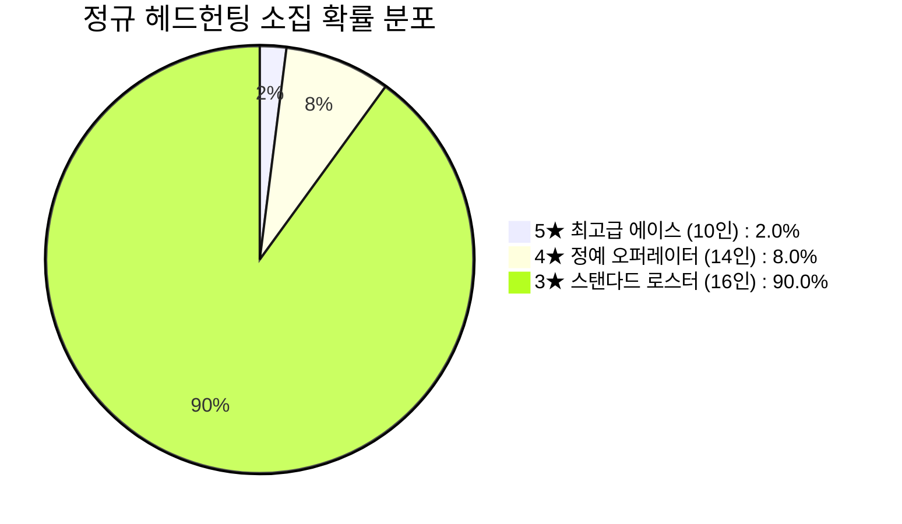

# [Project: Checkmate RPG] 정규 소집 풀 대확장 명세서 (Expanded 40-Operator Roster)

> **문서 버전:** v1.0 (공식 대확장 제정본)  
> **기준 일자:** 2026-09-28  
> **대상 풀 규모:** 총 40인 정규 소집 로스터 (**5★ 에이스 10인 / 4★ 정예 14인 / 3★ 스탠다드 16인**)  
> **기획 핵심:** `UnitSubclassType` 64종 서브클래스 100% 매핑, 명일방주식 성급 밸런스 프레임워크(스탯 격차 15% 이내 제어, 툴킷 유연성 차별화), 체급(Weight) 및 체스 위치전 전술 다변화  
> **문서 상태:** 단일 기준점 (Single Source of Truth)  
> **연동 시스템:** `UnitData`, `RecruitHubUI`, `RecruitBannerData`, `OperatorHubUI`, `SaveData`

---

## 📑 목차 (Table of Contents)

1. [대확장 로스터 설계 원칙 및 성급 구조](#1-대확장-로스터-설계-원칙-및-성급-구조)
2. [전체 40인 오퍼레이터 총괄 매트릭스](#2-전체-40인-오퍼레이터-총괄-매트릭스)
3. [★★★★★ (5성 에이스 / 최고급 오퍼레이터 - 10인) 상세 명세](#3--5성-에이스--최고급-오퍼레이터---10인-상세-명세)
4. [★★★★ (4성 정예 오퍼레이터 - 14인) 상세 명세](#4--4성-정예-오퍼레이터---14인-상세-명세)
5. [★★★ (3성 스탠다드 오퍼레이터 - 16인) 상세 명세](#5--3성-스탠다드-오퍼레이터---16인-상세-명세)
6. [헤드헌팅 채널별 등장 가중치 및 픽업 로테이션 계획](#6-헤드헌팅-채널별-등장-가중치-및-픽업-로테이션-계획)
7. [엔지니어링 데이터 연동 및 ScriptableObject 생성 가이드](#7-엔지니어링-데이터-연동-및-scriptableobject-생성-가이드)

---

## 1. 대확장 로스터 설계 원칙 및 성급 구조

### 1.1 성급별 밸런스 및 툴킷(Toolkit) 차별화 원칙
1. **스탯 격차 15% 이내 통제 (체스식 수싸움 보존):**
   - 3성과 5성의 기초 스탯 차이는 최대 15%를 넘지 않습니다.
   - 3성 폰이나 룩도 5성의 공격을 버텨내며 라인을 형성하고 AP를 수급할 수 있습니다.
2. **툴킷의 깊이와 유연성 차별화:**
   - **★★★ (3성 - 16인):** [1 패시브 + 1 고정 액티브] — 단일 목적 전문형(Single-Purpose Tool). 저렴한 육성비와 직관적인 안정성.
   - **★★★★ (4성 - 14인):** [1~2 패시브 + 2선택 액티브] — 상황 대응 및 파티 시너지형(Multi-Tool). 진형 변환, 위치 스왑, 장판 제어.
   - **★★★★★ (5성 - 10인):** [2 패시브 + 3선택 액티브 (사선 컷인 궁극기 포함)] — 전술적 완성형(Tactical Custom Kit). 독보적 전장 장악력과 스킬 커스텀 자유도.

---

## 2. 전체 40인 오퍼레이터 총괄 매트릭스

| 기물 (Piece) | 5★ 에이스 (10인) | 4★ 정예 (14인) | 3★ 스탠다드 (16인) |
| :---: | :--- | :--- | :--- |
| **폰 (Pawn) [비용 1 / 경량 체급 1]** | • **지크프리트** (에이전트 / 퀸 왕귀형) | • **플래그** (기수 / 65 AP 대량 펌핑) • **아이작** (공병 / 장애물 바리케이드) • **체이서** (정찰병 / 6 AP 초저비용 도약) • **척후대장** (정찰선봉 / 팀 AP 즉발 +20) | • **레오** (척후대 / 초당 +0.8 AP 생산) • **바론** (방어대 / 0 AP 고기방패 도발) • **클로에** (돌격대 / 처치 시 15 AP 환불) • **로빈** (사수 / 전방 ㄱ자 곡사 포격) • **섀도우** (스파이 / 연속이동 도발·은신) |
| **나이트 (Knight) [비용 2 / 중형 체급 2]** | • **키아라** (검객 / 2연타 출혈 폭딜) • **칼리** (마검사 / 적 SP 소각 암살) | • **환영기사** (교란기사 / 적-아군 위치 스왑) • **발키리** (창기병 / 1자 2칸 동시 관통) • **볼트** (총수 / 십자 2칸 원형 원거리 요격) | • **카일** (돌격기사 / 도약 직후 확정 누킹) • **롤랑** (근위기사 / 착지 1.5초 기절 CC) • **루카스** (성기사 / 100% 마법 나이트) • **페가수스** (기동기사 / 18 AP 초고속 기동) |
| **비숍 (Bishop) [비용 2 / 중형 체급 2]** | • **엘레나** (저격수 / 사각지대 킹 결전암살) • **미네르바** (집정관 / 가로열 전체 빔) • **세라피나** (성역술사 / 광역 결전보호막) | • **지형술사** (지형술사 / 요구 AP +4 늪지대) • **전술사제** (수호사제 / 지원 계수 1.25x 힐) • **라일라** (마도사 / 3회 연쇄 체인라이트닝) • **네크로** (령술사 / 폰 시체 언데드 소환) | • **셀레나** (대주교 / 대각선 마법 누커) • **노아** (사제 / 지원 계수 1.1x 힐·정화) • **에녹** (이단심문관 / 십자 광역 화염) • **루미** (요정 / 8 AP 초가성비 비숍) |
| **룩 (Rook) [비용 3 / 중장 체급 3]** | • **베스타** (공성병기 / 대장갑 40% 트루뎀) • **아틀라스** (수호거신 / 무지성 국밥 딜탱) • **가이아** (주포 / 빈땅 지정 3칸 넉백) | • **근위대장** (근위대장 / 방어력 +35 오라) • **바솔로뮤** (집행관 / 전방 3칸 적 그랩) • **이그제큐터** (포탑 / 사거리 자동 포격) | • **브록** (포트리스 / 2칸 넉백 Splat 유도) • **이그니스** (마탑 / 마법저항 40% 침묵 탱커) • **테레사** (수호자 / 피해 40% 대리 흡수) |
| **퀸 (Queen) [비용 4~5 / 중장 체급 3]** | • **릴리스** (마녀 / 8방향 점멸 광역 혼돈) | • **게일** (공주 / 28 AP 가성비 퀸) | *(3성 퀸은 밸런스 및 체스 격식상 배제)* |

---

## 3. ★★★★★ (5성 에이스 / 최고급 오퍼레이터 - 10인) 상세 명세

> **5성 공통 사양:**  
> • 최대 레벨: 공명 0단계 Lv.50 ➔ 공명 1단계 Lv.70 ➔ **공명 2단계 Lv.85 (최종)**  
> • 스킬 툴킷: 2 패시브 + **3 액티브 스킬 (자유 세팅)**  
> • 궁극 연출: **3스킬 시전 시 전용 사선 컷인(Cinematic Cut-In) 연출 발동**

---

### 3.1. 키아라 (Kiara) — 나이트 / 검객 (Swordmaster)
* **컨셉:** 전광석화의 이도류 발도재. 명일방주 첸/아이린형 연속 참격 누커.
* **기초 스탯 (Lv 1):** HP 700 / DEF 32 / RES 5% / ATK 155 / AP 24 / 체급 2 (Middle)
* **재능 구성:**
  - **[제1재능] 깊숙한 열상:** 1회 행동 시 2회 연속 타격. 매 3번째 공격마다 대상에게 영구 중첩 가능한 [출혈] 부여.
  - **[제2재능 (공명2)] 혈흔 추적:** 출혈 상태인 적 타격 시 물리 방어력을 20% 무시하고 공격 속도 +15%.
* **선택형 스킬 (3택):**
  - **[1스킬] 섬광 삼단격 (SP 5, 공격 회복, 자동):** 다음 타격이 3연속 공격(타당 120%)으로 강화되며 대상의 출혈 스택을 즉시 폭발시킴.
  - **[2스킬] 잔영 보법 (SP 45, 자동 회복, 수동):** 15초간 이동 소모 AP -6 감소(24→18 AP) + 치명타 확률 +40%.
  - **[3스킬] 오의: 나선비검 (SP 80, 자동 회복, 수동) [사선 컷인]:** 24초간 공격 주기 60% 단축, 공격 소모 AP 절반(12 AP), 사거리 1칸 확장, 매 타격 100% 확률로 광역 출혈 난무.

---

### 3.2. 엘레나 (Elena) — 비숍 / 저격수 (Sniper)
* **컨셉:** 침묵의 대구경 저격수. 명일방주 앰브리엘/파죰카형 원거리 킹 킬러.
* **기초 스탯 (Lv 1):** HP 460 / DEF 14 / RES 15% / ATK 210 / AP 24 / 체급 2 (Middle)
* **재능 구성:**
  - **[제1재능] 초장거리 저격 조준경:** 주변 2칸 이내의 적을 공격할 수 없는 사각지대 존재 ↔ 3칸 이상 떨어진 적 타격 시 최종 피해 +35% 증폭.
  - **[제2재능 (공명2)] 에테르 철갑탄:** 적의 물리 방어력 30%를 무시하며, 룩 및 퀸에게 주는 피해 +25% 추가 증폭.
* **선택형 스킬 (3택):**
  - **[1스킬] 고정밀 탄환 (SP 4, 공격 회복, 자동):** 다음 공격력 +140%, 탄도 궤적 상의 첫 번째 적에게 2초간 [비틀거림] 부여.
  - **[2스킬] 위장 매복 진지 (SP 40, 자동 회복, 수동):** 20초간 완전 은신(적의 원거리 공격 타겟팅 불가), 공격력 +50%, 공격 사거리 +1칸 확장.
  - **[3스킬] 궤도 탄도학: 체크메이트 (SP 85, 자동 회복, 수동) [사선 컷인]:** 즉시 맵 전체에서 적 지휘관(킹)을 자동 조준. 방어력을 100% 무시하는 공격력 450%의 절대 저격 탄환 발사.

---

### 3.3. 베스타 (Vesta) — 룩 / 공성병기 (SiegeWeapon)
* **컨셉:** 중장갑 궤도 포탑형 공성병기. 명일방주 혼(Horn)형 장거리 고정피해 포격수.
* **기초 스탯 (Lv 1):** HP 1,100 / DEF 55 / RES 10% / ATK 210 / AP 36 / 체급 3 (Heavy)
* **재능 구성:**
  - **[제1재능] 요새 격파자:** 2칸 이상 거리 타격. 적 룩이나 방어력 35 이상 적 타격 시 피해의 40%를 **고정 피해(True Damage)**로 전환.
  - **[제2재능 (공명2)] 시즈 섀시:** 상시 밀치기/당기기(Knockback/Pull) 완전 면역 + 받는 모든 피해 20% 상시 감쇄.
* **선택형 스킬 (3택):**
  - **[1스킬] 충격 철갑탄 (SP 6, 공격 회복, 자동):** 대상을 3칸 강제 넉백 (벽 충돌 시 MaxHP 10% Splat 피해 유도) + 방어력 30% 파괴.
  - **[2스킬] 시타델 시즈 모드 (SP 50, 자동 회복, 수동):** 18초간 이동 불가 고정, 포격이 십자(+) 1칸 범위 폭발로 변경되며 공격력 +60%.
  - **[3스킬] 지평선 붕괴: 궤도 수직 포격 (SP 90, 자동 회복, 수동) [사선 컷인]:** 전방 직선 전체를 꿰뚫는 거대한 에너지 빔 방사 (공격력 320% 마법 피해 + 대상 방어력 비례 추가 고정 피해).

---

### 3.4. 아틀라스 (Atlas) — 룩 / 수호거신 (Guardian Colossus)
* **컨셉:** 전선을 홀로 지탱하는 무지성 국밥형 딜탱. 명일방주 사리아/마운틴형.
* **기초 스탯 (Lv 1):** HP 1,050 / DEF 58 / RES 15% / ATK 145 / AP 36 / 체급 3 (Heavy)
* **재능 구성:**
  - **[제1재능] 철벽 가드:** 자신 및 인접 1칸 아군이 받는 물리 피해 20% 상시 감쇄. 아군 피격 시 피해 50%를 대리 흡수.
  - **[제2재능 (공명2)] 긴급 수복 나노봇:** HP 50% 이하 진입 시 즉시 최대 체력의 40% 회복 + 10초간 방어력 +50% (전투당 1회).
* **선택형 스킬 (3택):**
  - **[1스킬] 비축 충격 (SP 5, 피격 회복, 자동):** 다음 평타 공격력 190% + 전방 2칸 넉백.
  - **[2스킬] 생체 치유 오라 (SP 35, 자동 회복, 자동):** 매 6초마다 주변 8칸 내 체력이 가장 낮은 아군과 자신의 HP를 공격력의 160%만큼 자동 치유.
  - **[3스킬] 난공불락의 요새 (SP 75, 피격 회복, 수동) [사선 컷인]:** 25초간 방어력 +120%, 인접 적 이동 요구 AP 2배 증가, 아군 전체 30% 데미지 컷 오라 전개.

---

### 3.5. 릴리스 (Lilith) — 퀸 / 마녀 (Witch)
* **컨셉:** 체스판 8방향을 자유자재로 유린하는 최고위 에테르 마녀.
* **기초 스탯 (Lv 1):** HP 850 / DEF 28 / RES 30% / ATK 195 / AP 48 / 체급 3 (Heavy)
* **재능 구성:**
  - **[제1재능] 차원 왜곡:** 퀸의 8방향 이동 경로 상의 적을 뛰어넘어 순간이동 가능. 지나간 경로에 5초간 마법 균열 장판 생성.
  - **[제2재능 (공명2)] 에테르 폭주:** 마법 피해를 입힌 적의 SP 충전을 2초간 정지시키고 마법 저항력 -20% 붕괴.
* **선택형 스킬 (3택):**
  - **[1스킬] 에테르 오브 (SP 6, 자동 회복, 자동):** 8방향 직선 상 가장 가까운 적 2명에게 공격력 180%의 마법 유도탄 발사.
  - **[2스킬] 공간 도약 폭격 (SP 40, 자동 회복, 수동):** 3칸 이내 빈 타일로 즉시 텔레포트 후 착지 지점 주변 8칸에 공격력 250% 마법 폭발 + 2초 속박.
  - **[3스킬] 종말의 체크메이트 룬 (SP 90, 자동 회복, 수동) [사선 컷인]:** 20초간 퀸의 모든 이동 AP 소모가 50% 할인되며, 턴마다 전장 전체 무작위 적 4명에게 낙뢰(공격력 220% 마법 피해) 연속 투하.

---

### 3.6. 지크프리트 (Siegfried) — 폰 / 에이전트 (Agent)
* **컨셉:** 유일하게 적진 끝(8열) 도달 시 전설의 5성 퀸 '기사왕'으로 대역전 프로모션하는 왕귀형 폰.
* **기초 스탯 (Lv 1):** HP 420 / DEF 18 / RES 10% / ATK 80 / AP 8 / 체급 1 (Light)
* **재능 구성:**
  - **[제1재능] 잠입 작전:** 적에게 피격당하지 않는 한 이동 요구 AP가 4로 반감 (8→4 AP).
  - **[제2재능 (공명2)] 왕의 계승자:** 적진 8열 도달 시 즉시 퀸(기사왕 모드)으로 승급하며, HP 100% 완전 회복 및 모든 스탯 +200% 영구 폭증.
* **선택형 스킬 (3택):**
  - **[1스킬] 전력 질주 (SP 30, 자동 회복, 수동):** 즉시 전방으로 2칸 전진 (경로 상 적이 있어도 뛰어넘음).
  - **[2스킬] 연막 은폐 (SP 40, 피격 회복, 수동):** 8초간 자신에게 완전 은신 부여 + 다음 1회 타격 시 확정 치명타(200%).
  - **[3스킬] 엑스칼리버 해방 (SP 70, 자동 회복, 수동) [사선 컷인]:** 승급 전에는 전방 3칸에 공격력 300% 검기 발사. 승급 후에는 퀸의 8방향 전체에 공격력 500% 성검 일섬.

---

### 3.7. 미네르바 (Minerva) — 비숍 / 집정관 (Archon)
* **컨셉:** 적 가로열 전체를 일격에 초토화하는 결전 마법 포격수.
* **기초 스탯 (Lv 1):** HP 520 / DEF 16 / RES 25% / ATK 190 / AP 24 / 체급 2 (Middle)
* **재능 구성:**
  - **[제1재능] 전술 연산 과부하:** 적이 스킬을 시전할 때마다 미네르바의 SP가 즉시 +15 충전.
  - **[제2재능 (공명2)] 에테르 소각:** 마법 공격 적중 시 적 팀의 공유 AP를 -4 소각.
* **선택형 스킬 (3택):**
  - **[1스킬] 응축 광탄 (SP 5, 공격 회복, 자동):** 대각선 타겟팅 폭발, 적중 대상 주변 4칸에 공격력 170% 스플래시 피해.
  - **[2스킬] 침묵의 결계 (SP 45, 자동 회복, 수동):** 지정한 3x3 타일에 8초간 결계를 생성하여 결계 내 모든 적 스킬 시전 불가(침묵) 부여.
  - **[3스킬] 아케인 제네시스: 초토화 광선 (SP 80, 자동 회복, 수동) [사선 컷인]:** 적 지휘관이 위치한 가로열 전체에 극대 마법 레이저 발사. 해당 열의 모든 기물에게 공격력 350% 마법 피해 및 3초간 기절.

---

### 3.8. 칼리 (Kali) — 나이트 / 마검사 (Spellblade)
* **컨셉:** 적의 SP를 빼앗아 자신의 검기에 불을 붙이는 안티 메이지 암살 기사.
* **기초 스탯 (Lv 1):** HP 680 / DEF 26 / RES 20% / ATK 160 / AP 24 / 체급 2 (Middle)
* **재능 구성:**
  - **[제1재능] 마력 강탈:** 공격 적중 시 대상의 현재 SP를 10 강탈하여 자신의 SP로 전환.
  - **[제2재능 (공명2)] 잔혹한 참수:** 체력이 30% 이하인 적 타격 시 최종 피해 +50% 증폭 및 즉시 처치 시 AP 12 환불.
* **선택형 스킬 (3택):**
  - **[1스킬] 마력 점화검 (SP 4, 공격 회복, 자동):** 다음 타격을 100% 마법 피해로 전환하고 공격력 180% 피해 + 마법 저항력 -15% 삭감.
  - **[2스킬] 그림자 쇄도 (SP 40, 자동 회복, 수동):** 사거리 무제한으로 SP가 가장 높은 적 나이트/비숍의 배후 L자 타일로 즉시 도약 기습(공격력 220% 피해).
  - **[3스킬] 마검오의: 칠흑의 처형 (SP 70, 공격 회복, 수동) [사선 컷인]:** 20초간 공격력이 80% 증가하며, 평타마다 적의 스킬 쿨다운을 3초씩 밀어내고 대상의 방어력과 마저를 모두 30% 무시.

---

### 3.9. 가이아 (Gaia) — 룩 / 주포 (MainCannon)
* **컨셉:** 초원거리 곡사 포격으로 적 진형을 붕괴시키는 장갑 주포차.
* **기초 스탯 (Lv 1):** HP 1,150 / DEF 52 / RES 10% / ATK 225 / AP 48 / 체급 3 (Heavy)
* **재능 구성:**
  - **[제1재능] 지면 강타:** 포격 지점의 타일을 10초간 균열 상태로 만들어 통과하는 적에게 이동 저하 40% 부여.
  - **[제2재능 (공명2)] 충격파 반동:** 피격 시 30% 확률로 공격한 적을 1칸 밀쳐내며 반격 피해 80% 반사.
* **선택형 스킬 (3택):**
  - **[1스킬] 고폭탄 사격 (SP 6, 공격 회복, 자동):** 타겟 및 인접 8칸에 공격력 160% 스플래시 물리 피해.
  - **[2스킬] 빈 땅 강제 지정 포격 (SP 45, 자동 회복, 수동):** 적이 없는 빈 타일을 지정 사격 가능. 해당 타일 3x3 범위에 공격력 240% 피해 + 중심부 밖으로 2칸 넉백.
  - **[3스킬] 타이탄 버스터: 종말 포격 (SP 85, 자동 회복, 수동) [사선 컷인]:** 적 진영 중심부에 거대한 지각 붕괴 유탄 투하. 9칸 범위에 공격력 380% 물리 피해 + 3칸 강제 넉백 (Splat 10% 유도).

---

### 3.10. 세라피나 (Seraphina) — 비숍 / 성역술사 (SanctifiedCaster)
* **컨셉:** 전장을 빛으로 채우는 궁극의 지원형 대사제.
* **기초 스탯 (Lv 1):** HP 490 / DEF 18 / RES 30% / ATK 130 / **지원 계수 1.35x** / AP 24 / 체급 2 (Middle)
* **재능 구성:**
  - **[제1재능] 은총의 성역:** 세라피나가 위치한 대각선 상의 모든 아군은 받는 치유량 +20% 증가 및 디버프 지속시간 50% 단축.
  - **[제2재능 (공명2)] 최후의 수호천사:** 아군 기물이 치사 피해를 입을 때 죽지 않고 HP 1로 생존하며 3초간 무적 보호막 부여 (작전당 1회).
* **선택형 스킬 (3택):**
  - **[1스킬] 성스러운 기도 (SP 4, 자동 회복, 자동):** 최저 체력 아군 2명에게 공격력 130% × 지원계수만큼 즉시 치유.
  - **[2스킬] 축복의 방벽 (SP 40, 자동 회복, 수동):** 아군 전체에게 공격력 180% × 지원계수의 보호막을 12초간 부여하고 이동 AP 소모 -4 할인.
  - **[3스킬] 성역 강림: 천상의 안식 (SP 75, 자동 회복, 수동) [사선 컷인]:** 15초간 전장 전체에 성역 전개. 모든 아군 초당 최대 HP의 8% 지속 회복, 받는 모든 피해 40% 감쇄, 적의 모든 공격 속도 30% 감속.

---

## 4. ★★★★ (4성 정예 오퍼레이터 - 14인) 상세 명세

> **4성 공통 사양:**  
> • 최대 레벨: 공명 0단계 Lv.40 ➔ 공명 1단계 Lv.60 ➔ **공명 2단계 Lv.70 (최종)**  
> • 스킬 툴킷: 1~2 패시브 + **2 액티브 스킬 (선택 세팅)**  
> • 포지션: 상황 적응력과 파티 시너지의 핵심 가교 (스위스 아미 나이프형)

---

| 번호 | 캐릭터명 | 기물 | 서브클래스 | 속성 / 체급 | 핵심 재능 (Passive) | 액티브 스킬셋 (2택) |
| :---: | :--- | :---: | :--- | :---: | :--- | :--- |
| **01** | **환영기사 (Mirage)** | 나이트 | 교란기사 | 마법 / 2 | 체급 2 이하 대상 타격 시 20% 확률로 혼란 부여 | **[1스킬] 전술 위치 교환 (SP 35):** 사거리 내 적/아군과 자신의 위치를 맞바꿈 + 2초 침묵 **[2스킬] 환영 분신 (SP 45):** 10초간 자신과 동일한 외형의 허상 분신 소환 (어그로 흡수) |
| **02** | **지형술사 (Terra)** | 비숍 | 지형술사 | 마법 / 2 | 마법 공격 적중 타일에 8초간 균열 생성 | **[1스킬] 늪지대 형성 (SP 35):** 지정 타일 4칸을 늪으로 변형 (적 통과 요구 AP +4 증가) **[2스킬] 대지의 가시 (SP 45):** 대각선 타일 전체에 가시 솟구침 (공격력 180% 피해 + 1초 속박) |
| **03** | **근위대장 (Warden)** | 룩 | 근위대장 | 물리 / 3 | 인접 8칸 내 모든 아군 물리 방어력 +35 오라 | **[1스킬] 가로막기 (SP 30):** 인접 아군 피격 시 자동으로 몸을 던져 대신 피해 70% 흡수 **[2스킬] 방패 진압격 (SP 40):** 전방 1칸 180% 물리 피해 + 1칸 넉백 및 1.5초 기절 |
| **04** | **척후대장 (Pioneer)** | 폰 | 정찰선봉 | 물리 / 1 | 출전(배치) 즉시 팀 공유 AP +20 일시 충전 | **[1스킬] 기습 전진 (SP 25):** 2칸 도약 찌르기 (160% 물리 피해 + AP 6 환불) **[2스킬] 지휘 고무 (SP 45):** 12초간 주변 4칸 폰의 공격력을 +30% 증폭 |
| **05** | **전술사제 (Sanctuary)**| 비숍 | 수호사제 | 지원 / 2 | **지원 계수 1.25x** 특화 힐러 | **[1스킬] 단일 응급 수혈 (SP 30):** 아군 1명에게 240% × 지원계수 즉발 힐 **[2스킬] 보호의 장막 (SP 40):** 아군 1명에게 피격 피해 30%를 흡수하는 방어 보호막 부여 |
| **06** | **플래그 (Flag)** | 폰 | 기수 | 물리 / 1 | 스킬 시전 중 공격을 완전히 중단하는 대신 AP 폭증 | **[1스킬] 군기 고정 (SP 22):** 12초간 공격 중단, 즉시 35 AP 생산 **[2스킬] 총진격 신호 (SP 38):** 15초간 공격 중단, 55 AP 지속 생산 + 아군 전체 이속 +25% |
| **07** | **아이작 (Isaac)** | 폰 | 공병 | 물리 / 1 | 인접한 아군 룩의 방어력을 상시 +15% 수리 | **[1스킬] 바리케이드 설치 (SP 30):** 빈 타일 1칸에 내구도 600의 장애물 방벽 소환 **[2스킬] 지뢰 매설 (SP 40):** 타일에 은신 지뢰 매설 (적 밟을 시 250% 물리 폭발 + 넉백) |
| **08** | **발키리 (Valkyrie)** | 나이트 | 창기병 | 물리 / 2 | L자 착지 대신 바라보는 직선 2칸 동시 관통 | **[1스킬] 일렬 돌진 (SP 30):** 전방 2칸 직선 상 모든 적 관통 (190% 물리 피해 + 1칸 넉백) **[2스킬] 천공의 강습 (SP 45):** 3칸 도약 착지하며 십자 5칸에 210% 물리 피해 + 비틀거림 |
| **09** | **볼트 (Bolt)** | 나이트 | 총수 | 물리 / 2 | 십자 방향 2번째 칸 원형 범위를 타격하는 사거리 연장 | **[1스킬] 철갑 저격탄 (SP 28):** 원거리 적 1명에게 200% 물리 피해 (방어력 25% 무시) **[2스킬] 섬광탄 투척 (SP 40):** 타겟 지점에 섬광탄 투하 (주변 적 4초간 명중률 -50% 실명) |
| **10** | **체이서 (Chaser)** | 폰 | 정찰병 | 물리 / 1 | 이동 소모 AP 6 (초저비용 기동), 적 1회 뛰어넘기 | **[1스킬] 그림자 질주 (SP 25):** 6초간 완전 은신 + 다음 타격 시 공격력 +100% 기습 피해 **[2스킬] 연막 탈출 (SP 35):** 피격 시 즉시 뒤로 1칸 후퇴하며 연막 전개 |
| **11** | **라일라 (Lyla)** | 비숍 | 마도사 | 마법 / 2 | 대각 타격 시 최대 3명의 적에게 연쇄 튕김 (타당 70%) | **[1스킬] 과부하 번개 (SP 32):** 연쇄 번개 피해 + 1.5초 감전(마비 CC) **[2스킬] 전자기장 방출 (SP 42):** 주변 8칸에 180% 마법 피해 + 적의 현재 SP -20 삭감 |
| **12** | **바솔로뮤 (Bartholomew)**| 룩 | 집행관 | 물리 / 3 | 체력 최상위, 전방 적을 자신 앞으로 끌어당김 | **[1스킬] 사슬 갈고리 (SP 28):** 직선 3칸 내 적 1명을 끌어당겨 1.5초 기절시킴 **[2스킬] 단두대 강타 (SP 45):** 끌어당긴 적에게 260% 물리 피해 (출혈 상태 시 피해 2배) |
| **13** | **게일 (Gale)** | 퀸 | 공주 | 물리 / 3 | 28 AP로 기동하는 경량형 고유틸성 가성비 퀸 | **[1스킬] 유려한 검무 (SP 30):** 8방향 적 1명 200% 물리 피해 + 자신의 이동 AP -8 반감 **[2스킬] 바람의 장막 (SP 45):** 10초간 원거리 투사체 회피율 70% 증가 |
| **14** | **네크로 (Necro)** | 비숍 | 령술사 | 마법 / 2 | 아군 폰 전사 시 50% 확률로 체력 40% 언데드 폰 소환 | **[1스킬] 시체 폭발 (SP 35):** 전사한 폰의 잔해를 폭파하여 주변 8칸에 230% 마법 피해 **[2스킬] 영혼 착취 (SP 45):** 적 1명에게 지속 도트 마법 피해를 입히며 자신의 HP 흡혈 |

---

## 5. ★★★ (3성 스탠다드 오퍼레이터 - 16인) 상세 명세

> **3성 공통 사양:**  
> • 최대 레벨: 공명 0단계 Lv.30 ➔ 공명 1단계 Lv.45 ➔ **공명 2단계 Lv.55 (최종)**  
> • 스킬 툴킷: **1 패시브 + 1 고정 액티브** (초저비용 고효율, 덱의 기초 뼈대)  
> • 특징: 육성 재료 소모량이 5성의 30% 수준으로 초반 스토리 돌파 및 자원 파밍의 핵심 대들보

---

| 번호 | 오퍼레이터명 | 기물 | 서브클래스 | 속성 / 체급 | 고유 패시브 (재능) | 고정 액티브 스킬 (단일 툴) |
| :---: | :--- | :---: | :--- | :---: | :--- | :--- |
| **01** | **레오 (Leo)** | 폰 | 척후대 | 물리 / 1 | 필드 생존 중 **초당 +0.8 AP 공급** | **[SP 40] 선봉 기동:** 다음 1회 이동 AP 0 + 5초간 방어력 +15 |
| **02** | **바론 (Baron)** | 폰 | 방어대 | 물리 / 1 | **평타 AP 소모 0**, 인접 적 이동 요구 AP +4 증가 | **[SP 45] 방패 참호:** 8초간 광역 도발 + 받는 물리 피해 30% 감쇄 |
| **03** | **클로에 (Chloe)** | 폰 | 돌격대 | 물리 / 1 | **평타 AP 소모 0, 적 처치 시 15 AP 즉시 환불** | **[SP 35] 돌파 찌르기:** 전방 1칸 190% 물리 피해 + [비틀거림] |
| **04** | **로빈 (Robin)** | 폰 | 사수 | 물리 / 1 | 전방 대각선 + 전방 ㄱ자(나이트 타격점) 2칸 타격 | **[SP 50] 다리 묶기 볼트:** 사거리 내 적 180% 물리 피해 + 감속 35% |
| **05** | **섀도우 (Shadow)** | 폰 | 스파이 | 물리 / 1 | 연속 이동 시 도발 발동 / 쿨 대기 정지 시 완전 은신 | **[SP 30] 기습 암살:** 은신 해제 직후 첫 타격 공격력 +150% 증폭 |
| **06** | **카일 (Kyle)** | 나이트 | 돌격기사 | 물리 / 2 | L자 점프 이동 직후 첫 평타 피해 **+30% 증폭** | **[SP 50] 돌격 강타:** 220% 물리 피해 + 1칸 넉백 |
| **07** | **롤랑 (Roland)** | 나이트 | 근위기사 | 물리 / 2 | 인접 1칸 내 모든 아군 **물리 방어력 +20 오라** | **[SP 45] 진압 낙하:** L자 점프 착지점 적 1명 **1.5초 기절(Stun)** |
| **08** | **루카스 (Lucas)** | 나이트 | 성기사 | 마법 / 2 | 평타가 **100% 마법 피해**로 전환 (고방어 룩 카운터) | **[SP 55] 성스러운 일격:** 180% 마법 피해 + 마법 저항력 20% 붕괴 |
| **09** | **페가수스 (Pegasus)**| 나이트 | 기동기사 | 물리 / 2 | 이동 소모 AP가 18로 매우 저렴 (초고속 전장 기동) | **[SP 35] 질주 도약:** 즉시 연속으로 2회 L자 점프 이동 수행 |
| **10** | **셀레나 (Selena)** | 비숍 | 대주교 | 마법 / 2 | 대각 2칸 이상 원거리 타격 시 마법 피해 +15% 증폭 | **[SP 50] 대주교의 심판:** 대각 사거리 내 적 1명에게 **260% 마법 폭발** |
| **11** | **노아 (Noah)** | 비숍 | 사제 | 지원 / 2 | 평타 대신 사거리 내 **최저 체력 아군 70% 힐** | **[SP 40] 정화의 기도:** 아군 1명 **220% 즉시 힐 + 디버프 정화** |
| **12** | **에녹 (Enoch)** | 비숍 | 이단심문관| 마법 / 2 | 평타 적중 시 대상 및 인접 십자(+) 4칸 40% 확산 피해 | **[SP 60] 업화의 불길:** 타겟 중심 십자 5칸 170% 마법 피해 + 화상 도트 |
| **13** | **루미 (Lumi)** | 비숍 | 요정 | 마법 / 2 | 배치 코스트 1, 행동 소모 AP 8의 초가성비 견제 비숍 | **[SP 30] 요정의 장난:** 사거리 내 무작위 적 1명의 현재 SP -15 소각 |
| **14** | **브록 (Brock)** | 룩 | 포트리스 | 물리 / 3 | 체급 3 (Heavy). 받는 물리 피해 **-8 추가 감산** | **[SP 50] 충격파 방패치기:** 160% 물리 피해 + **2칸 넉백 (Splat 유도)** |
| **15** | **이그니스 (Ignis)** | 룩 | 마탑 | 마법 / 3 | **마법 저항력 40%**, 평타 마법 피해 적용 | **[SP 55] 마법 침묵 포격:** 직선 상 적 190% 마법 피해 + **2.5초 침묵** |
| **16** | **테레사 (Teresa)** | 룩 | 수호자 | 물리 / 3 | 인접 1칸 아군이 받는 피해의 **40% 대리 흡수** | **[SP 50] 수호의 서약:** 6초간 **최대 체력 25% 보호막** + 초당 3% 자가 힐 |

---

## 6. 헤드헌팅 채널별 등장 가중치 및 픽업 로테이션 계획

### 6.1 상시 헤드헌팅 채널 (Standard Headhunting)
* **대상:** 40인 전체 오퍼레이터 상시 등장.
* **확률 배분:**
  - 5★ 에이스 (10인): 각 0.20% (합계 2.0%)
  - 4★ 정예 (14인): 각 0.57% (합계 8.0%)
  - 3★ 스탠다드 (16인): 각 5.625% (합계 90.0%)

### 6.2 픽업 헤드헌팅 채널 (Featured Pickup - 2주 로테이션)
* **픽업 대상:** 특정 5성 1인 (5성 등장 확률의 **50%인 1.0%** 독점 배정).
* **로테이션 스케줄 안:**
  - **Pick-up 1차:** `[기동 타격대]` — **키아라 (5★ 나이트)** + 환영기사 / 발키리 (4★)
  - **Pick-up 2차:** `[저격의 지평선]` — **엘레나 (5★ 비숍)** + 지형술사 / 라일라 (4★)
  - **Pick-up 3차:** `[철벽의 성채]` — **베스타 (5★ 룩)** + 근위대장 / 바솔로뮤 (4★)
  - **Pick-up 4차:** `[에테르 폭풍]` — **릴리스 (5★ 퀸)** + 플래그 / 체이서 (4★)

---

## 7. 엔지니어링 데이터 연동 및 ScriptableObject 생성 가이드

### 7.1 에셋 생성 및 명명 규칙
* **저장 경로:** `Assets/Resources/Units/{UnitID}.asset`
* **에셋 명명 규칙:**
  - 5성: `Elena`, `Kiara`, `Vesta`, `Atlas`, `Lilith`, `Siegfried`, `Minerva`, `Kali`, `Gaia`, `Seraphina`
  - 4성: `Mirage`, `Terra`, `Warden`, `Pioneer`, `Sanctuary`, `Flag`, `Isaac`, `Valkyrie`, `Bolt`, `Chaser`, `Lyla`, `Bartholomew`, `Gale`, `Necro`
  - 3성: `Leo`, `Baron`, `Chloe`, `Robin`, `Shadow`, `Kyle`, `Roland`, `Lucas`, `Pegasus`, `Selena`, `Noah`, `Enoch`, `Lumi`, `Brock`, `Ignis`, `Teresa`

### 7.2 `UnitData.cs` 인스펙터 설정 규격 매핑
* `Rarity`: 3 / 4 / 5
* `PieceType`: Pawn / Knight / Bishop / Rook / Queen
* `Subclass`: `UnitSubclassType` Enum 1:1 매핑
* `WeightTier`: 1 (Light) ~ 3 (Heavy)
* `SupportPower`: 서포터/힐러(1.10 ~ 1.35), 딜탱(1.00)

---

## 8. 결론

본 문서를 통해 Checkmate RPG는 **체스 5대 기물(폰/나이트/비숍/룩/퀸)의 전략성과 서브컬처 RPG의 매력적인 캐릭터 수집 욕구를 완벽히 만족하는 총 40인의 대규모 정규 소집 풀**을 정식 확립하였습니다.
