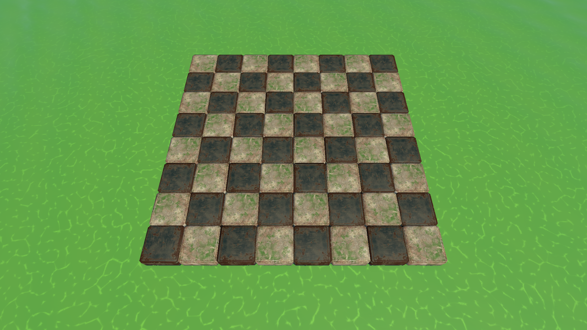
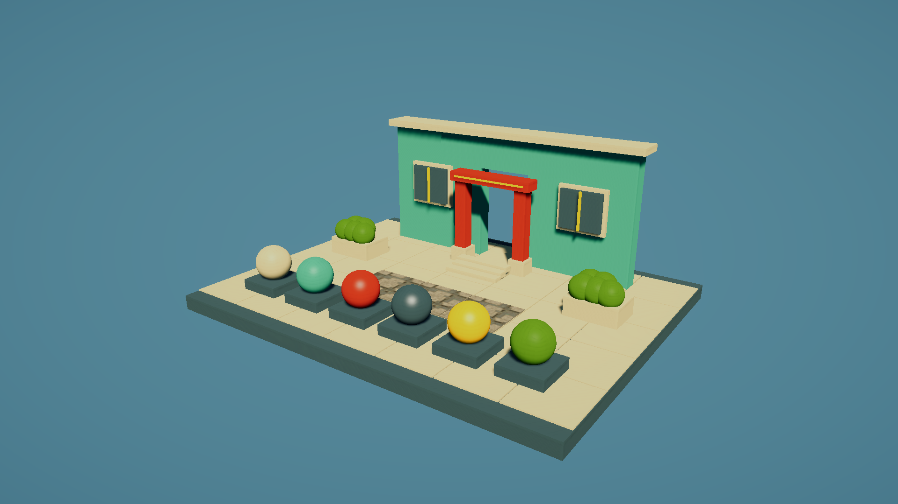

# 서브컬쳐 풍 배경 셰이더

2026-09-10 · Unity 6000.3.10f1 / URP 17.3.0

## 체스보드 적용 (후속 수정)

실제 용도에 맞춰 `Assets/Resources/Materials/RuinTiles.mat`에 적용했다. BattleScene의 TileRock / TileMetal 64칸과 이 공유 재질을 사용하는 프리팹에 반영된다. 기존 재질 GUID, 보드 메시·UV·배치와 원본 텍스처를 유지한다.

- 밝은 돌칸 / 어두운 청회색 금속칸 대비를 유지한다.
- 기존 BaseMap, NormalMap, MaskMap을 사용한다. 기존 NormalMap을 새 셰이더의 BumpMap에도 연결했다.
- Use Packed Tile Mask를 켜면 R은 금속 부분 색·하이라이트, G는 AO, A는 하이라이트 폭에 반영한다. 원본 텍스처와 임포트 설정은 변경하지 않았다.
- Masked Metal Tint로 금속칸만 조절한다. 현재 (0.30, 0.46, 0.57); 밝은 돌 무늬와 녹·균열은 유지한다.
- 보드 프리셋: Normal Strength 0.45, Stylization 0.55, Transition Softness 0.5, AO 0.65, Highlight Strength 0.1, Saturation 0.9, Haze 0.
- 원래 재질 백업: `Assets/Environment/StylizedBackground/RuinTilesOriginal.mat`. 필요하면 해당 재질을 배정해 이전 표현을 비교할 수 있다.
- BattleScene 실제 Play 렌더에서 64칸, 기물 8개 및 파란 이동 가능 칸 테두리를 확인했다. 셰이더 메시지/콘솔 오류·경고 0, SRP Batcher 코드 0. Play Mode 종료.
- 이 후속 작업은 셰이더와 공유 재질만 변경했으며 씬·전투 코드를 수정하지 않았다. 이전 턴의 109개 테스트 결과는 위 후속 변경의 새 테스트 결과가 아니며, 이번에는 렌더 검증을 수행했다.

이하 일반 재질 예시 씬은 보조 자료이며 실제 적용 결과는 위 체스보드를 기준으로 한다.

## 결과와 적용

셰이더: **Checkmate / Environment / Stylized Background**

- 미리보기 씬: `Assets/Environment/StylizedBackground/BackgroundMaterialStudy.unity`
- 재사용 프리팹: 같은 폴더의 `BackgroundMaterialStudy.prefab`
- 재질 7종: 같은 폴더의 `Materials/`
- 생성 메뉴: `Tools > Checkmate > Background > Create Material Study`, `Create Preview Scene`
- 이미 생성된 프리팹/씬은 메뉴로 덮어쓰지 않는다. 해당 에셋을 직접 열어 사용한다.

1. 미리보기 씬을 열고 Play를 누르면 조명과 ACES 톤 매핑이 설정된 재질 비교 공간을 볼 수 있다.
2. 실제 배경에는 기존 재질을 복제하고 Shader를 위 셰이더로 바꾼다. Base Texture, Base Color, Normal Map을 확인한다.
3. 또는 Materials 폴더의 프리셋을 복제해 배경 메시 Renderer에 넣는다.
4. 게임 씬의 조명과 톤 매핑에 따라 결과가 달라지므로 아래 값을 조절한다.

일반 미리보기 공간은 재질을 확인하기 위한 단순한 구조물이며 참고 이미지의 도시·지형 모델을 재현한 에셋은 아니다. 실제 체스보드에는 위 후속 수정이 적용되어 있다.

## 표현과 조절값

참고 이미지의 따뜻한 표면색, 청록 계열 음영, 텍스처가 남는 완만한 명암, 거리감 표현을 재질 단위로 제공한다. 강한 외곽선은 사용하지 않는다.

| Inspector 항목 | 역할 |
|---|---|
| Stylization | 0은 연속적인 확산 명암, 1은 단순화한 명암 경계. 기본 0.7 |
| Transition Softness | 명암 경계의 폭. 낮추면 셀 셰이딩, 높이면 부드러운 곡면 |
| Cool Shadow Tint / Warm Light Tint | 그림자 보조광과 햇빛 색 |
| Painted Shadow Fill | 주광이 닿지 않는 부분의 색을 살리는 보조광. 기본 0.12, 물리적인 반사량은 아님 |
| Ambient Strength | 기존 환경광·라이트맵의 기여도 |
| Normal Strength | 노멀맵 강도. 기본 0.6 |
| Soft Highlight Strength / Highlight Smoothness | 하이라이트 양과 폭. 도장 금속용 근사이며 금속 반사 워크플로는 아님 |
| Texture Saturation | 텍스처 채도. 기본 1.08 |
| Occlusion (Green) | AO 맵의 G 채널. 기본 흰색 |
| Emission Mask / Color | 간판·발광 부분. 블룸은 씬 Volume에서 별도 설정 |
| Distance Haze Strength | 거리 안개. 기본 0으로 비활성화 |
| Haze Start / End | 카메라로부터의 월드 거리. 기본 30 / 140 |
| Alpha Cutout / Cutoff | 잎사귀·철망처럼 구멍이 있는 불투명 재질. 부드러운 반투명은 미지원 |
| Cull Mode | 기본 Back. 양면 카드가 필요할 때 Off |

Haze는 URP Fog와 함께 적용된다. 씬 Fog를 사용 중이면 재질 Haze를 0으로 두고 필요할 때만 추가한다. Inspector의 Alpha Cutout을 사용하면 키워드도 설정된다. 코드에서 변경할 때는 `_AlphaClip` 값과 `_ALPHATEST_ON` 키워드를 함께 바꿔야 한다.

WarmConcrete, TealPlaster, VermilionPaint, BlueGreyMetal, OchreTrim, Foliage, MechanicalFloor 프리셋을 포함한다. MechanicalFloor만 기존 MechanicalRuins 바닥 텍스처를 참조하며 원본 재질/텍스처는 수정하지 않는다. Foliage는 단색 표면 프리셋이며 바람이나 잎사귀 텍스처를 새로 생성한 것은 아니다.

## 구현 범위

- 메인 라이트와 추가 라이트, 실시간 그림자, 노멀맵, AO, emission, fog.
- 정적 라이트맵 샘플링과 베이크용 Meta 패스.
- ShadowCaster, DepthOnly, DepthNormalsOnly 패스. 깊이 노멀 패스는 메시 노멀을 사용한다.
- SRP Batcher 호환, GPU 인스턴싱 변형.
- ForwardOnly 경로 사용. APV, 동적 라이트맵, 커스텀 모션 벡터, Terrain 레이어 블렌딩, 투명 표면, 반사 프로브 기반 금속 반사는 구현 범위 밖이다.
- 프로젝트 설정·패키지·게임 규칙을 수정하지 않는다. 런타임 Update 컴포넌트를 추가하지 않는다.

## 검증 결과

- Unity C# 컴파일 및 ShaderUtil 최종 셰이더 메시지: 오류/경고 0.
- SRP Batcher 호환 코드: 0.
- BattleScene Play Mode에서 임시 프리팹 렌더 확인 후 종료; 임시 오브젝트가 제거된 것을 확인.
- 생성한 미리보기 씬에서도 Play Mode 렌더, 그림자 수신·투영, 텍스처 표시 확인.
- 런타임 복제 재질과 MaterialPropertyBlock으로 거리 안개와 알파 컷아웃을 변경해 렌더 확인. 원본 재질에 검증값을 저장하지 않음.
- 테스트 도중과 종료 후 Unity 콘솔 오류/경고 0. 마지막에는 Play Mode 종료 후 BattleScene 복귀.
- 기존 `CheckmateRPG.Tests` Edit Mode 테스트 109개 실행 완료, 실패 1건 보고. 작업 ID: `67446aac230a4798b99ed3583bdff3da`.
- 실패: `StatusEffectRegressionTests.Processor_Poison_GeneratesTrueDamageBasedOnMagnitude`. 기대 피해 5 / 실제 4. 기존 StatusEffectProcessor의 실수 계산 후 FloorToInt 경로와 관련된 실패이며 이 작업에서 전투 코드나 테스트를 변경하지 않음.
- Computer Use는 창 탐색은 가능했지만 캡처가 `SetIsBorderRequired / 0x80004002`로 재시도 후에도 실패. 실제 화면 확인은 Unity MCP 카메라 렌더로 수행.
- Test Runner 실행 전 BattleScene이 dirty였고, 테스트 시작 시 기존 미저장 씬 변경이 저장되었다. 되돌리지 않았으며 배경 프리팹은 Play Mode에서만 임시 배치했다.
- 실제 라이트맵 베이크, Forward+ 전용 렌더러, XR/모바일, 성능 벤치마크는 미실행.

커밋/병합은 수행하지 않았다.
