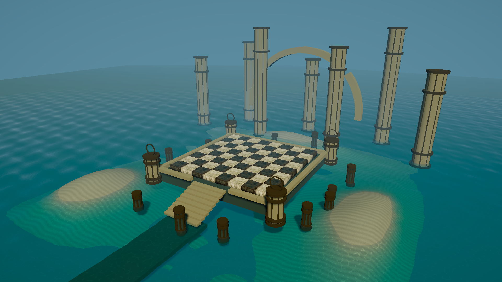
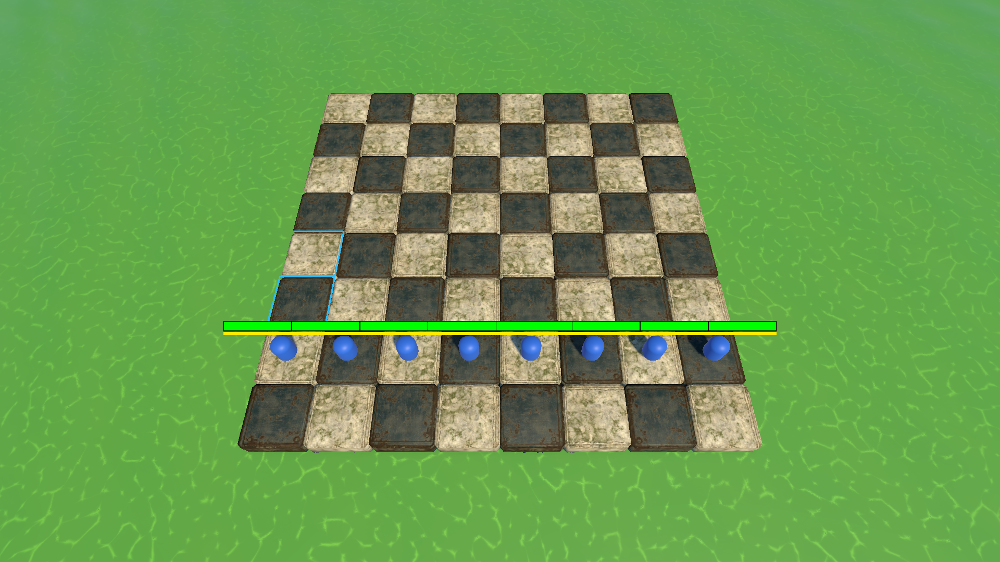
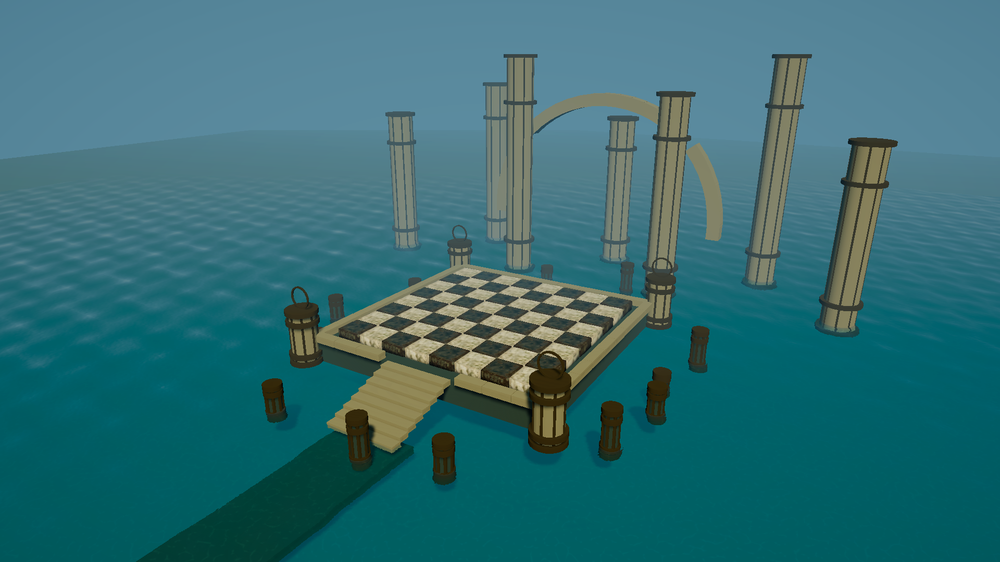

# 침수된 기계 유적 — 씬 제작 준비

## 작은 Terrain 추가

`07 Small Shore Terrain - 48m`에 실제 Unity Terrain과 TerrainCollider를 추가했다. 크기는 48×48m, 높이맵 129×129, 위치는 (-16, -4.5, -16)이다. 중앙은 잠긴 낮은 지반으로 유지하고 좌우와 후방에 낮은 수변을 배치했다. 보드·계단·수면·카메라의 원래 위치는 유지한다.

`Assets/Environment/SunkenCourt/Terrain/`의 TerrainData·TerrainLayer·URP Terrain 재질에 저장했다. 기존 SandRipples 텍스처를 참조하고 TerrainLayer 색을 낮췄다. Unity Terrain의 Raise/Lower, Smooth, Paint Texture 도구로 이어서 수정할 수 있다. 기존 호수 바닥은 Terrain 바깥쪽 배경용으로 남겨 두었다.

## 변경과 열기

- 씬: `Assets/Environment/SunkenCourt/SunkenCourt_Blockout.unity`
- 편집 텍스처: `Assets/Environment/SunkenCourt/Textures/RuinTiles_SunkenCourt_BaseMap.png`
- 기존 `RuinTiles.mat`에 편집본 연결. BaseColor를 (1.15, 1.19, 1.22)로 내려 밝아진 석재의 노출을 보정했다.
- 원본 BaseMap, NormalMap, MaskMap 및 메시·UV는 그대로 보존했다. 석재는 밝은 아이보리, 이끼는 올리브, 금속 주변 부식은 낡은 청동 색으로 조정했다.
- 복구: RuinTiles의 BaseMap에 `Assets/Resources/Textures/RuinTiles/Tile_Low_DefaultMaterial_BaseMap.png`를 다시 연결. 이전 BaseColor는 (1.35, 1.40, 1.43).

## 현재 씬의 의미

완성 배경이 아니라 배치·크기·조명 검토용 아트 블록아웃이다. 전투 스테이지로 등록하지 않았으며 전투 매니저나 입력 시스템이 없다. 원래 BattleScene은 유지하고 공용 보드 재질의 텍스처만 반영했다.

Hierarchy를 작업별로 나눴다.

1. **01 Board**: 기존 TileRock / TileMetal 프리팹으로 구성한 8×8 보드. 칸 크기 2, X/Z 범위 0–16, 셀 중심 1,3,…,15. 원래 보드 높이 유지.
2. **02 Raised Platform and Stairs**: 보드 아래 단상과 전방 진입 계단. 전투칸 바깥 영역.
3. **03 Corner Pylons**: 네 모서리 기둥과 원형 장식. 최종 모델로 교체할 실루엣.
4. **04 Background Silhouettes**: 후경 대형 기둥과 끊어진 아치. 정식 기계장치·기어 모델의 자리.
5. **05 Submerged Rubble and Causeway**: 수중 잔해·진입로·호수 바닥.
6. **06 Turquoise Water**: 기존 portable water 프리팹과 별도 CourtWater 재질. 원본 물 설정은 수정하지 않음.

메뉴 `Tools > Checkmate > Background > Create Sunken Court Blockout`으로 신규 생성할 수 있다. 기존 씬이 있으면 덮어쓰지 않고 중단한다.

## 다음 제작 순서

1. 실제 전투 카메라에서 64칸과 이동 범위 표시가 가려지지 않는 구도를 확정한다.
2. 단상 옆면·계단·기둥을 최종 석재 모듈로 교체한다. 장식은 플레이 영역 밖에 둔다.
3. 후경 아치를 기어/수로 모듈로, 상단 구조물을 부유 장치와 연결 교량으로 교체한다.
4. 얇은 이끼·넝쿨·청동 장식·깃발을 추가한다. 현 단계에는 식생/깃발 최종 에셋이 없다.
5. 반사 프로브·베이크·LOD·충돌·성능을 검증한 다음 별도 작업으로 정식 BattleScene에 통합한다.

현재 큰 기둥·아치·계단은 단색 기본 도형이며 레퍼런스의 정교한 건축물을 재현한 최종 에셋이 아니다. 수면·조명·안개는 분위기 검토용 시작값이다. AI 편집본은 UV atlas의 큰 배치를 유지하지만 세부 균열 픽셀까지 원본 노멀과 일치하는 재베이크 텍스처는 아니다. 확대 시 최종 아트 단계에서 경계·노멀 정합을 확인한다.

## 이미지 생성 기록

내장 ImageGen 사용, CLI/API 미사용. 입력 1은 원본 BaseMap 편집 대상, 입력 2는 사용자가 첨부한 침수 유적 분위기 참고.

프롬프트: “Edit FIRST image ONLY: production game base-color UV texture atlas. SECOND image is mood/color reference only, not composition. Output exactly square same atlas composition. Subtle material retouch for sunken ancient mechanical cathedral chessboard. ABSOLUTE invariant: preserve every existing UV island location, silhouette, scale, bevel border, seam, rivet and crack registration, all padding and stretched dilation, no rearrangement, no perspective, no new objects, no text. Left two stone square islands: modestly brighten toward aged warm ivory limestone, gently reduce noisy red-brown dirt and saturated grass-green moss, keep existing cracks and moss placements but muted olive sparse moss. Right metal islands: retain existing worn metal areas and rust mask placement, shift rusty brown edges toward aged dark bronze with restrained desaturated patina, metallic face muted warm grey. Make only subtle color and fine-detail refinements, retain at least 90% original structure. Flat diffuse albedo only, no baked directional illumination, shadows, reflections or scene. Do not draw the reference scene or chessboard arrangement; preserve first image's technical UV atlas.”

## 검증

- 에디터 코드 컴파일 오류 0.
- BattleScene Play에서 보드 64칸, 기물·이동 테두리 렌더 확인, 콘솔 오류/경고 0.
- 정식 씬의 파일/전투 규칙/기존 원본 텍스처는 이 작업에서 수정하지 않음.
- 기존 전투 테스트는 이번 아트 작업에서 재실행하지 않음. 이전 109개 실행/독 피해 실패 1건 기록은 이번 결과가 아님.
- 신규 씬 Play 렌더 완료, 콘솔 오류/경고 0, Play Mode 종료 확인. 전환 중 MCP 연결이 일시 끊겼으나 재연결 후 검증했다.
