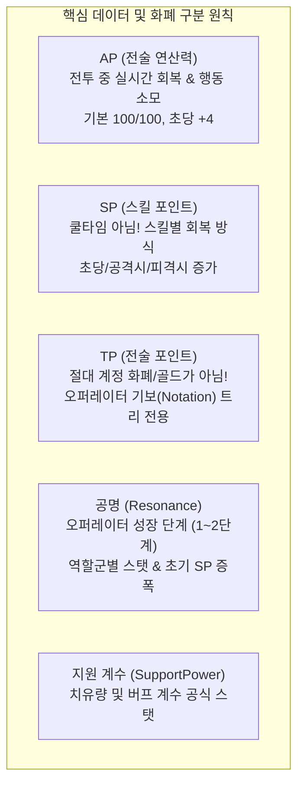
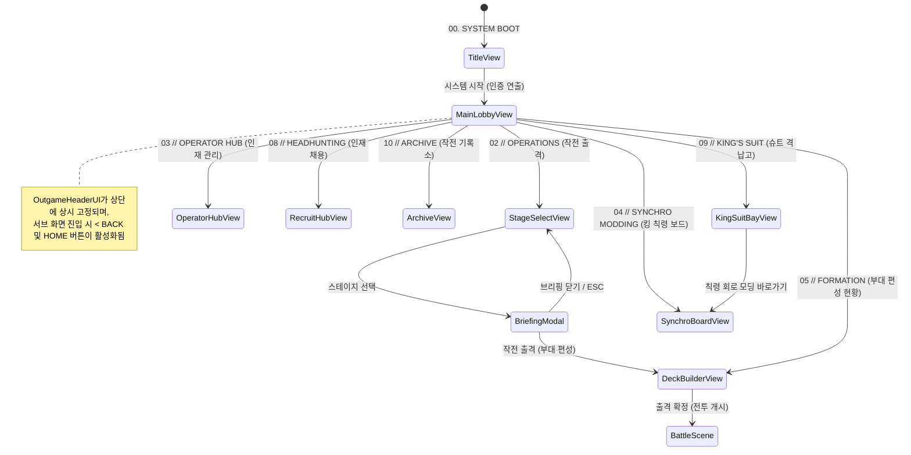

# [Project: Checkmate RPG] UI/UX 시스템 및 화면 흐름 개발 명세서 (UI Specification)

> **문서 버전:** v2.1 (무채색 전술 UI 아트 디렉션 및 화면 동선 보정)
> **최종 수정일:** 2026-09-27  
> **대상 플랫폼:** PC / 모바일 (1920 × 1080 FHD 기준, CanvasScaler 0.5 대응)  
> **기획 핵심 원칙:** 부활 시스템 배제, SP 시스템 규격화, TP(전술 포인트) 비화폐화 원칙 엄수, 지원 계수(SupportPower) 연동

---

## 1. 비주얼 시스템 — 2026-09-27 개정

최신 사용자 요청에 따라 네온 시안·주황·금색을 동시에 강조하던 v2.0 팔레트를 교체한다.
레퍼런스: 명일방주(정보 위계와 비대칭 메뉴), Warframe(장비·칙령 구성), 명일방주: 엔드필드 및 명조(여백과 타이포그래피).

- 화면의 기본은 먹색·회백색. 한국어 기능명을 크게, 영문 시스템 코드를 작게 배치한다.
- 출격 버튼은 황토색, 선택 항목은 회백색 반전. 위험은 붉은색, 전투 SP/AP는 저채도 청회색.
- 색을 입힌 패널 반복, 과도한 네온·글로우, 콘텐츠 위 대형 워터마크를 사용하지 않는다.
- 버튼 배경 Image와 ColorBlock의 중복 곱셈을 피한다. 키보드 선택·호버·누름·비활성 상태를 구분한다.
- 화면 흐름과 실제 데이터 연결은 기존 뷰가 담당하고, 공통 배치 유틸리티 `TacticalLayout`이 시각 요소만 구성한다.

| 토큰 | HEX | 용도 |
|---|---|---|
| BackgroundBase | #191B1C | 화면 배경 |
| SurfaceDark | #222526 | 작업 영역 |
| SurfaceCard | #303435 | 카드·보조 버튼 |
| SurfaceCardLight | #454B4D | 호버·선택 표면 |
| BorderSubtle | #606767 | 구분선 |
| Paper | #E6E5DF | 주요 정보판·선택 반전 |
| Ink | #191C1D | 밝은 표면 위 텍스트 |
| AccentCyan / AccentTeal | #8CB9C1 | 전투 AP·SP, 보조 상태 |
| AccentOrange | #D7AA50 | 출격 행동 (기존 토큰 이름 유지) |
| AccentGold | #D7BB79 | 킹·칙령 상태 |
| AccentRed | #DB7671 | 위험 |
| TextWhite | #F3F2EC | 주요 텍스트 |
| TextMuted | #B1B7B4 | 설명 |
| TextDim | #7D8583 | 대형 장식 기호 |

### 적용 및 후속 경계

- 타이틀·로비는 원화를 배경으로 쓰고 우측 비대칭 메뉴와 좌측 상태·대사 영역을 배치한다.
- **부관은 사용자가 직접 설정하는 것이 최종 의도다.** 이번에 생성한 원화는 임시 시각 자료이며 사용자의 후속 지시에 따라 이번 작업에서는 수정하지 않는다. 원화의 캐릭터를 고정 부관이나 신규 대원으로 정의하지 않는다. 부관 선택·보유 대원 연동은 이번 작업에 추가하지 않는다.
- 작전 목록은 스크롤 영역으로 분리하고 브리핑 모달은 기존 데이터를 표시한다.
- 편성은 현재 게임 규칙의 가로 8슬롯(기존 문서의 6슬롯과 차이 있음), 킹 식별, 슬롯 교체 흐름을 유지한다. 아이콘 없는 대원은 기물 이니셜로 표시한다.
- 대원 관리에는 지원 계수와 실제 스킬의 SP 회복 방식을 표시한다.
- 채용 UI의 기존 콜백에는 실제 지급 처리가 없다. 등록 완료나 확률 상승을 주장하지 않고 시험 통신으로 표시한다.
- 아래 v2.0 화면 세부 설명 중 네온 색상·버튼 크기·워터마크 관련 표현보다 본 절과 최신 구현을 우선한다. 게임 규칙의 차이는 임의로 확정하지 않는다.
- 검증 결과는 `Parallel/Handoffs/ui-art-direction.md`에 별도 기록한다. 아래 과거 체크리스트는 이번 변경의 검증 근거가 아니다.

---

## 2. 핵심 게임 규칙 및 UI 데이터 연동 원칙



### 2.1 TP (Tactical Points / 전술 포인트) 표기 절대 원칙
1. **TP는 계정 통화나 재화(Gold/Credit)가 아니다.**
2. 공통 상단 네비게이션 헤더(`OutgameHeaderUI`)나 메인 로비(`MainLobbyUI`) 상단에 골드나 보석처럼 "보유 TP: XXX" 형태로 절대 노출하지 않는다.
3. TP는 오직 **오퍼레이터 허브의 기보(Notation) 퍼즐 트리 해금 화면** 내부에서 해당 오퍼레이터의 투자 가능 포인트로만 표기한다.
4. 로비 상단 및 상태 요약 영역에는 TP 대신 **지휘관 슈트 레벨(`SuitLevel`)** 및 **작전 완수 구역 수(`ClearedStages.Count`)**를 표기한다.

### 2.2 SP (Skill Points / 스킬 포인트) 시스템 규격
1. 스킬은 쿨타임(Cooldown) 방식이 아니며, **SP 충전 게이지**로 작동한다.
2. 스킬마다 회복 방식이 다르다:
   - **자동 회복(Auto Recovery):** 초당 일정량 회복
   - **공격 회복(Offensive Recovery):** 일반 공격 적중 시 충전
   - **피격 회복(Defensive Recovery):** 적 공격 피격 시 충전
3. 스킬마다 요구 최대 SP가 상이하며, SP 완충(100%) 시 수동 혹은 조건 발동이 가능해진다.
4. UI에서는 스킬 아이콘 주변 게이지 바 및 `[EX READY]` 펄싱 이펙트로 완충 상태를 피드백한다.

### 2.3 지원 계수 (SupportPower) 스탯 반영
1. 유닛 기본 스탯에 **지원 계수 (`SupportPower`)**가 존재한다.
2. 치유 스킬(`Heal`) 발동 시: $\text{최종 치유량} = \text{기본 힐량} \times \text{시전자 SupportPower}$
3. 버프 스킬(`Buff`) 발동 시: $\text{최종 버프 수치} = \text{기본 수치} \times \text{시전자 SupportPower}$
4. 오퍼레이터 허브의 능력치 탭에 **"지원 계수: X.XX"** 형태로 정식 표기한다.

### 2.4 부활 시스템 배제 원칙
1. 본 프로젝트에는 부활(Revival / Resurrect) 시스템이 존재하지 않는다.
2. 체력이 0이 된 기물은 즉시 퇴각/파괴되며, 지휘관(킹)이 쓰러질 경우 즉시 체크메이트(패배)로 종료된다.
3. UI 상에 부활 횟수, 부활 쿨타임, 부활 토큰 등의 잔재 요소가 노출되지 않도록 전면 배제한다.

---

## 3. 전체 화면 흐름도 및 네비게이션 구조



### 3.1 화면 관리자 (`OutgameUIManager`)
* **역할:** 아웃게임의 모든 패널(`OutgameViewBase`) 생명주기 관리 및 화면 전환 애니메이션(페이드 + 0.95 스케일 팝) 총괄.
* **화면 히스토리 스택 (`_historyStack`):** 뒤로가기(`GoBack()`) 호출 시 직전 화면으로 정확히 역추적. 스택이 빌 경우 `MainLobby`로 자동 복귀 안전장치 내장.
* **모달 닫기 스택 (`_modalCloseActions`):** 브리핑 모달, 인벤토리 팝업 등 오버레이 창이 열렸을 때 `ESC` 키 입력 시 상위 화면으로 튕기지 않고 모달만 순차 닫힘 처리.
* **화면 전환 이벤트 (`OnViewChanged`):** 화면 전환 시 뷰 타입을 브로드캐스팅하여 `OutgameHeaderUI`가 자동 갱신되도록 연동.

---

## 4. 공통 컴포넌트 명세

### 4.1 통합 상단 네비게이션 헤더 (`OutgameHeaderUI`)
* **컴포넌트 위치:** Canvas 최상단 (`anchorMin: (0, 1)`, `anchorMax: (1, 1)`, 높이 75px, `SetAsLastSibling` 최상위 계층 보장)
* **비주얼 구성:**
  - **배경:** `rgba(15, 18, 23, 0.92)` 딥 다크 글래스 + 하단 2px 네온 슬레이트 경계선
  - **좌측 네비게이션:**
    - `< BACK` 버튼 (이전 뷰 복귀, 메인 로비 및 타이틀에서는 자동 숨김)
    - `HOME` 버튼 (메인 로비 즉시 복귀, 서브 뷰에서만 노출)
    - 화면 타이틀 브레드크럼 (`02 // OPERATIONS  작전 출격`, `05 // FORMATION  작전 부대 편성` 등)
  - **우측 시스템 인디케이터:**
    - `COMMANDER  SUIT LV.X` (현재 지휘관 슈트 코어 레벨)
    - `● PRTS // ONLINE` (네온 시안 통신망 상태 배지)

---

## 5. 아웃게임 개별 화면 상세 명세

### SCR-00. Title View (시스템 부팅 & 시작)
* **식별 코드:** `OutgameViewType.Title` (`TitleUI.cs`)
* **레이아웃:**
  - 중앙 배경: 은은한 `CHECKMATE RPG` 대형 워터마크
  - 중앙 하단: `SYSTEM START` (크기 400 × 100px, 프라이머리 하이테크 버튼)
* **특이사항:** 타이틀 화면에서는 `OutgameHeaderUI`가 완전히 숨겨짐 (`alpha = 0`, `blocksRaycasts = false`).

---

### SCR-01. Main Lobby (사령부 커맨드 센터)
* **식별 코드:** `OutgameViewType.MainLobby` (`MainLobbyUI.cs`)
* **레이아웃 구조:**
  - **좌측 상단 터미널 카드 (`TerminalStatusCard`):**
    - `지휘관 슈트 코어: Lv.X`
    - `작전 완수: N 구역` (클리어한 스테이지 수 실시간 반영)
  - **중앙 부관 영역 (`AssistantCard` & `SpeechBubblePanel`):**
    - 부관 카드 프레임 (`ASSISTANT OPERATOR // PRTS TACTICAL LIAISON`)
    - 하단 `[ TOUCH TO COMMUNICATE ]` 터치 구역
    - 터치 시 상단에 다크 글래스 말풍선이 팝업되며 지휘관 전술 대사 출력 후 3.5초 뒤 자연 페이드아웃
  - **우측 7대 사이버네틱 메뉴 타일 그리드:**
    - `02 // OPERATIONS (작전 출격)`: 대형 420 × 130px, **택티컬 오렌지 강조 카드**
    - `03 // OPERATOR HUB (오퍼레이터 관리)`: 420 × 85px
    - `04 // SYNCHRO MODDING (킹 칙령 보드)`: 420 × 85px
    - `05 // FORMATION (부대 편성 현황)`: 420 × 85px
    - `08 // HEADHUNTING (인재 채용)`: 420 × 85px
    - `09 // KING'S SUIT (슈트 격납고)`: 좌측 인접 열 380 × 85px
    - `10 // ARCHIVE (작전 기록소)`: 좌측 인접 열 380 × 85px

---

### SCR-02. Stage Select & Tactical Briefing (작전 출격 & 전술 브리핑)
* **식별 코드:** `OutgameViewType.StageSelect` (`StageSelectUI.cs`)
* **주요 해결 사항 (버그 근절):**
  - 스테이지 목록 컨테이너(`StageListContainer`)의 `VerticalLayoutGroup`에 `childControlHeight = true`, `childControlWidth = true`, `spacing = 14f` 강제.
  - 모든 스테이지 버튼 프리팹에 `LayoutElement(preferredHeight = 84f, minHeight = 80f)`를 적용하여 긴 스테이지명 텍스트 줄바꿈 시에도 상하 버튼 겹침 현상을 100% 방지.
* **스테이지 슬롯 비주얼:**
  - `[클리어 완료]` (네온 시안) 또는 `[작전 가능]` (골드) 뱃지
  - 권장 레벨 표기 (`Lv.X`)
  - 스테이지 ID 및 작전명 (`OP-01 : 침공의 서막`)
* **전술 브리핑 모달 (`Tactical Briefing Modal`):**
  - 스테이지 버튼 클릭 시 화면 중앙에 다크 슬레이트 모달 팝업
  - 표시 정보: 작전명, 작전 목표(`[승리 조건] 적 지휘관 처치`), 적 전술 정보(위협 수준, 주력 기물), 작전 보상 요약
  - 버튼: `[ 작전 출격 (부대 편성) ]` (클릭 시 덱 빌더로 직결), `[ 닫기 ]` (`ESC` 연동)

---

### SCR-03. Operator Hub (오퍼레이터 육성 허브)
* **식별 코드:** `OutgameViewType.OperatorHub` (`OperatorHubUI.cs`)
* **레이아웃:**
  - **좌측 로스터 스크롤 패널 (22% 폭):** 보유 오퍼레이터 목록 및 직군 태그
  - **우측 상단 4대 탭 메뉴:** `[능력치]`, `[스킬]`, `[기보]`, `[공명]`
  - **세부 탭 콘텐츠:**
    1. **능력치 탭:** 체력, 공격력, 물리 방어력, 이동력, 공격 사거리, 공격 속도, 치명타 확률, 치유 계수, **지원 계수(SupportPower)** 등 9대 스탯 수치 표시
    2. **스킬 탭:** 3종 스킬 중 1종 선택 장착, 회복 방식(자동/공격/피격) 및 최대 SP 요구량 명시
    3. **기보(Notation) 탭:** 오퍼레이터 고유의 전술 기보 트리. **해당 오퍼레이터의 보유 TP를 소모하여 노드 해금**
    4. **공명(Resonance) 탭:** 공명 1~2단계 돌파 현황 및 직군별 보너스(공격력 +10%, 체력 +10%, 지원 계수 +10%, 초기 SP 보너스 등)

---

### SCR-04. Synchro Board (킹 칙령 모딩 보드)
* **식별 코드:** `OutgameViewType.SynchroBoard` (`SynchroBoardUI.cs`)
* **컨셉:** Warframe 스타일의 전술 회로 모딩 보드
* **구성 요소:**
  - **상단 수용량 게이지 (`CapacityMeter`):** 현재 장착 비용 합계 / 최대 수용량 (`Drain / Max Capacity`)
  - **중앙 절대 칙령 슬롯 (Absolute Slot):** 킹 고유의 오라(Aura) 칙령 슬롯. 장착 시 보너스 수용량 제공.
  - **하단 일반 칙령 슬롯 3기 (General Slots 1~3):** 극성(Polarity) 일치 시 장착 Cost 50% 할인, 불일치 시 25% 페널티 연산.
  - **칙령 선택 모달 (`EdictSelectorModal`):** 슬롯 클릭 시 보유 칙령 목록 표시 및 장착/해제.

---

### SCR-05. Squad Formation / Deck Builder (작전 부대 편성)
* **식별 코드:** `OutgameViewType.DeckBuilder` (`DeckBuilderUI.cs`)
* **구성 요소:**
  - **상단 전투력 배너 (`SquadRatingBanner`):**
    - 좌측: `SQUAD COMBAT RATING: XXX` (부대 종합 전투력 지수)
    - 우측: `• KING SYNCHRO: 회로 활성화 상태` (골드 텍스트)
  - **출전 덱 슬롯 (6슬롯 가로 그리드):**
    - **0번 슬롯 (KING):** `[KING]` 골드 태그, 앰버 테두리 강조, 덱 필수 포함 (제거 불가)
    - **1~5번 슬롯:** `[Knight]`, `[Pawn]`, `[Bishop]` 등 기물 직군 태그 및 이름 표시. 빈 슬롯은 대형 `+` 표시
  - **인벤토리 팝업 모달 (`InventoryPanel`):** 빈 슬롯이나 유닛 클릭 시 보유 대원 그리드 표출, 원클릭 교체 편성
  - **우측 하단 출격 버튼 (`StartBattleBtn`):** 300 × 80px, **택티컬 오렌지 강조 버튼**, 클릭 시 `BattleScene` 로드

---

### SCR-08. Headhunting / Recruit Hub (인재 채용 통신소)
* **식별 코드:** `OutgameViewType.Recruit` (`RecruitHubUI.cs`)
* **구성 요소:**
  - **좌측 픽업 통신 카드 (`01 // FEATURED PICKUP`):**
    - 타이틀: `기동 타격대 // KNIGHT TACTICAL`
    - 설명: 체스판 지형을 도약하여 적 후방을 급습하는 나이트 계열 특수 요원 확률 대폭 상승
    - 버튼: `[ 1회 소집 가동 ]`, `[ 10회 연속 소집 ]`
  - **우측 상시 채용 카드 (`02 // STANDARD HEADHUNTING`):**
    - 타이틀: `체스 정예 요원 상시 소집`
    - 설명: 폰, 룩, 비숍 등 전열 돌파 및 원거리 지원 핵심 기보 보유 대원 통상 채널 영입
    - 버튼: `[ 상시 채용 통신 ]`, `[ 10회 상시 채용 ]`
  - **하단 PRTS 통신 상태 콘솔 (`StatusConsole`):** 소집 버튼 클릭 시 실시간으로 대원 계약 접수 및 등록 피드백 텍스트 출력

---

### SCR-09. King's Suit Bay (지휘관 슈트 격납고)
* **식별 코드:** `OutgameViewType.KingSuitBay` (`KingSuitBayUI.cs`)
* **구성 요소:**
  - **슈트 규격 요약 카드 (`BayContainer`):**
    - 모델명: `TYPE-01 EXCALIBUR TACTICAL FRAME`
    - 코어 레벨: `Lv.X`
    - 장착 절대 칙령 오라 현황
    - 장착 일반 칙령 회로 수 (`N / 3 개`)
    - 칙령 수용량 현황 (`N / 30 점`)
  - **바로가기 버튼:** `[ 칙령 회로(Synchro) 모딩 열기 ]` (클릭 시 칙령 보드로 즉시 전환)

---

### SCR-10. Archive (전술 기록 보관소)
* **식별 코드:** `OutgameViewType.Archive` (`ArchiveUI.cs`)
* **구성 요소:**
  - **작전 기록 요약 카드 (`ArchiveContainer`):**
    - 완수된 작전 구역 수
    - 소집 및 등록된 오퍼레이터 수
    - 전술 분석 시스템: `PRTS TACTICAL ARCHIVE v1.0 ONLINE`
  - **4대 체스 RPG 전술 교리 명시:**
    1. 기물 고유의 이동 궤적과 AP 소모를 고려하여 전장을 선점하십시오.
    2. 아군의 체급(Weight)과 넉백(Knockback) 충돌을 활용하여 적 진형을 붕괴시키십시오.
    3. SP 충전 완료 시 발동 가능한 액티브 스킬은 전투의 흐름을 단숨에 전환합니다.
    4. 적 지휘관(킹) 처치 시 즉시 체크메이트(승리)가 선언됩니다.

---

## 6. 인게임 전투 HUD & 실시간 피드백 명세 (Combat HUD)

### 6.1 전투 HUD 레이아웃 와이어프레임
```
+-----------------------------------------------------------------------------------------------+
| [PAUSE]  STAGE 01-01        [ 1.0x / 2.0x ]  [ENEMY: 04/08]                      [AP: 42/100] |
| <Top Status Bar : Minimal Dark Glassmorphism UI>                                              |
+-----------------------------------------------------------------------------------------------+
|                                                                                               |
|                                     ( 8 x 8 전술 체스 보드 )                                  |
|         - 유닛 선택 시: 네온 시안 기동 가능 타일 하이라이트                                   |
|         - 적 위협/스킬 범위: 반투명 크림슨 레드 장판 경고                                     |
|         - 넉백 조준 시: Splat 충돌 위치 및 착지 고스트 실루엣 (Prediction Ghosting)           |
|                                                                                               |
+-----------------------------------------------------------------------------------------------+
| [선택 유닛 전술 카드]       | [====== AP GAUGE (전술 연산력 게이지) ======]   | [★ EX READY ★]     |
| HP / SP / 체급 / 스킬 정보  |  초당 +4 회복 / 소모 예측 시안 고스트 바 프리뷰 | 액티브 스킬 수동 발동 |
+-----------------------------------------------------------------------------------------------+
```

### 6.2 전투 핵심 피드백 요구사항
1. **플레이어 AP 게이지 (`PlayerAPBar`):**
   - 자연 회복(초당 +4 AP) 상태를 게이지 채움 애니메이션으로 표현.
   - 마우스로 기물 이동/공격 타일 조준(Hover) 시, 소모될 AP만큼 반투명 시안색 고스트 바가 줄어드는 프리뷰 제공.
   - AP가 부족한 상태에서 조작 시도시 게이지가 크림슨 레드로 점멸하며 `[INSUFFICIENT AP]` 경고 피드백 발생.
2. **월드스페이스 기물 상태바 (`UnitStatusBar`):**
   - 체스판 위 모든 기물 머리 위에 카메라를 향해 상시 빌보딩(Billboarding).
   - 체력 비율에 따라 녹색 → 황색 → 적색으로 변화하는 HP 바.
   - HP 바 하단에 SP 게이지 배치. 100% 충전 시 네온 시안으로 전환되며 `[★ EX READY ★]` 골드 펄싱 효과 발생.
   - 기물 체급(Weight: 깃털/추/바위/산) 아이콘을 상태바 좌측에 상시 노출하여 넉백 저항력 직관화.
3. **전술 예측 오버레이 (`Prediction Ghosting`):**
   - 기동 또는 넉백 스킬 조준 시, 최종 착지 타일과 벽/기물 충돌(Splat) 고정 피해가 발생하는 지점에 반투명 실루엣 및 데미지 수치 사전 렌더링.
4. **체크메이트 종결 연출 (`CheckmateCinematicUI`):**
   - 적 킹 처치 시 카메라 즉각 슬로우모션 줌인 + 화면 중앙을 가르는 대형 `[ C H E C K M A T E ]` 타이포그래피 슬래시 연출 후 전투 결과창(`BattleResultUI`)으로 전이.

---

## 7. 구현 클래스 및 컴포넌트 매핑 테이블

| 역할군 | 클래스명 | 파일 경로 | 주요 책임 및 연동 기능 |
| :--- | :--- | :--- | :--- |
| **스타일 토큰** | `OutgameStyle` | `Assets/Scripts/UI/OutgameStyle.cs` | 색상 토큰, 버튼/카드 스타일 적용 유틸리티 |
| **전체 UI 관리** | `OutgameUIManager` | `Assets/Scripts/UI/OutgameUIManager.cs` | 뷰 전환 애니메이션, 뒤로가기 스택, 모달 닫기 관리 |
| **상단 네비 헤더**| `OutgameHeaderUI` | `Assets/Scripts/UI/OutgameHeaderUI.cs` | 상단 고정 헤더, 타이틀, 뒤로가기/홈, 슈트 레벨 |
| **메인 로비** | `MainLobbyUI` | `Assets/Scripts/UI/MainLobbyUI.cs` | 로비 메뉴 타일, 부관 상호작용 및 대사, 상태 카드 |
| **스테이지 선택** | `StageSelectUI` | `Assets/Scripts/UI/StageSelectUI.cs` | 스테이지 목록(겹침 방지 레이아웃), 브리핑 모달 |
| **부대 편성** | `DeckBuilderUI` | `Assets/Scripts/UI/DeckBuilderUI.cs` | 6인 편성 그리드, 전투력 배너, 인벤토리 모달 |
| **로스터 슬롯** | `RosterSlotUI` | `Assets/Scripts/UI/RosterSlotUI.cs` | 킹 골드 슬롯, 기물 직군 태그(`[Knight]` 등) 표기 |
| **오퍼레이터 허브**| `OperatorHubUI` | `Assets/Scripts/UI/OperatorHubUI.cs` | 4대 탭(능력치/스킬/기보/공명), 지원 계수 반영 |
| **싱크로 보드** | `SynchroBoardUI` | `Assets/Scripts/UI/SynchroBoardUI.cs` | 절대 1/일반 3 칙령 회로, 수용량 연산 및 모달 |
| **인재 채용** | `RecruitHubUI` | `Assets/Scripts/UI/RecruitHubUI.cs` | 픽업/상시 배너, 1회/10회 소집, PRTS 콘솔 피드백 |
| **슈트 격납고** | `KingSuitBayUI` | `Assets/Scripts/UI/KingSuitBayUI.cs` | 슈트 코어 스펙, 칙령 도킹 요약, 모딩 바로가기 |
| **전술 기록소** | `ArchiveUI` | `Assets/Scripts/UI/ArchiveUI.cs` | 완수 구역, 오퍼레이터 통계, 4대 체스 전술 교리 |
| **씬 베이킹 빌더**| `OutgameSceneBuilder` | `Assets/Scripts/Editor/OutgameSceneBuilder.cs` | 전체 OutgameScene.unity 자동 구성 및 참조 주입 |
| **AP 게이지** | `PlayerAPBar` | `Assets/Scripts/UI/PlayerAPBar.cs` | 인게임 AP 회복, 소모 예측 Ghost Bar, 부족 경고 |
| **체크메이트 연출**| `CheckmateCinematicUI` | `Assets/Scripts/UI/CheckmateCinematicUI.cs` | 적 킹 처치 시 타이포그래피 슬래시 종결 연출 |
| **전투 결과창** | `BattleResultUI` | `Assets/Scripts/UI/BattleResultUI.cs` | 클리어 등급(체크메이트/승리/패배), 획득 보상 정산 |

---

## 8. 개발팀 검증 체크리스트

- [x] **공통 상단 네비게이션 헤더 검증:** 서브 뷰 진입 시 `< BACK`, `HOME` 정상 작동 및 타이틀 브레드크럼 자동 변경 확인.
- [x] **TP 화폐 오해 전면 배제:** 헤더 및 메인 로비에 "보유 TP"가 일체 노출되지 않고 작전 완수 구역 수로 정상 치환 확인.
- [x] **스테이지 리스트 겹침 버그 검증:** 해상도 변경 및 긴 작전명 상황에서도 84px 높이와 14px 간격으로 깔끔하게 정렬됨을 확인.
- [x] **전술 브리핑 모달 연동 검증:** 스테이지 선택 시 모달이 팝업되고, `작전 출격` 클릭 시 부대 편성 화면으로 직결됨을 확인.
- [x] **부대 편성 덱 빌더 검증:** 0번 킹 슬롯의 골드 하이라이트 및 일반 대원의 직군 태그(`[Knight]`, `[Pawn]`) 표출 확인.
- [x] **신규 허브 뷰(Recruit, KingSuit, Archive) 시각화 검증:** 플레이 모드에서 데이터가 정상적으로 바인딩되고 인터랙션 피드백이 발생함을 확인.
- [x] **전체 119개 EditMode 회귀 테스트 통과:** UI 및 규칙 변경 후에도 무결성 100% 유지 확인.